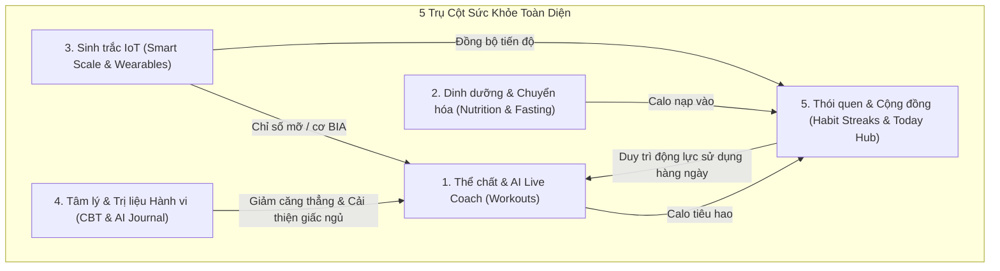
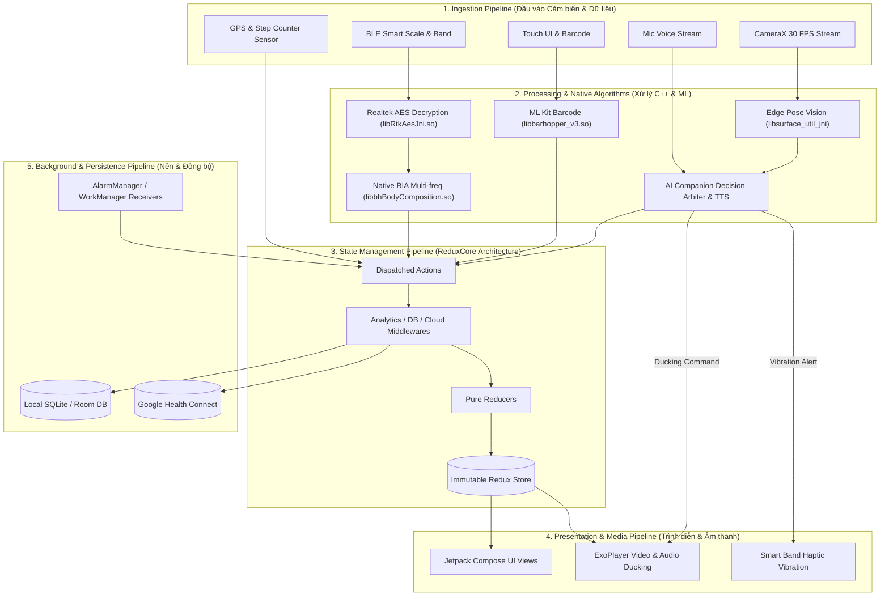
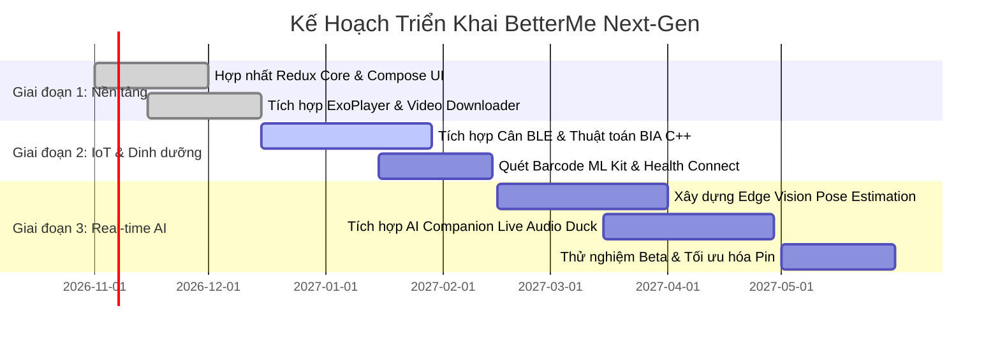

# DỰ ÁN: BETTERME NEXT-GEN — HỆ SINH THÁI HUẤN LUYỆN SỨC KHỎE TOÀN DIỆN VỚI REAL-TIME AI WORKOUT COMPANION
> **Tài liệu Đặc tả Ý tưởng Dự án, Kiến trúc Kỹ thuật & Danh mục Use Case Chi tiết**  
> *Định dạng: Hồ sơ Trình chiếu Ý tưởng Dự án (Project Pitch & Technical Specification Deck)*

---

## MỤC LỤC
1. [Tầm nhìn Dự án & Tuyên ngôn Giá trị (Project Vision & Value Proposition)](#1-tầm-nhìn-dự-án--tuyên-ngôn-giá-trị)
2. [Kiến trúc Hệ sinh thái Hợp nhất (Unified Ecosystem Architecture)](#2-kiến-trúc-hệ-sinh-thái-hợp-nhất)
3. [Danh mục & Phân tích Chi tiết Toàn bộ Use Case](#3-danh-mục--phân-tích-chi-tiết-toàn-bộ-use-case)
   - [Chủ đề 1: Khảo sát Thể trạng & Cá nhân hóa Lộ trình](#chủ-đề-1-khảo-sát-thể-trạng--cá-nhân-hóa-lộ-trình)
   - [Chủ đề 2: Huấn luyện Thể chất & Trợ lý Đồng hành Thời gian thực (Core AI Companion)](#chủ-đề-2-huấn-luyện-thể-chất--trợ-lý-đồng-hành-thời-gian-thực)
   - [Chủ đề 3: Dinh dưỡng Thông minh, Đếm Calo & Nhịn ăn Gián đoạn](#chủ-đề-3-dinh-dưỡng-thông-minh-đếm-calo--nhịn-ăn-gián-đoạn)
   - [Chủ đề 4: Tích hợp Thiết bị Thông minh IoT & Sinh trắc học BIA](#chủ-đề-4-tích-hợp-thiết-bị-thông-minh-iot--sinh-trắc-học-bia)
   - [Chủ đề 5: Sức khỏe Tinh thần, Liệu pháp Nhận thức Hành vi (CBT) & AI Journal](#chủ-đề-5-sức-khỏe-tinh-thần-liệu-pháp-nhận-thức-hành-vi-cbt--ai-journal)
   - [Chủ đề 6: Trung tâm Điều phối Ngày & Vòng lặp Thói quen](#chủ-đề-6-trung-tâm-điều-phối-ngày--vòng-lặp-thói-quen)
   - [Chủ đề 7: Mô hình Kinh doanh & Quản trị Thuê bao Premium](#chủ-đề-7-mô-hình-kinh-doanh--quản-trị-thuê-bao-premium)
4. [Toàn bộ 7 Tầng Pipeline Kỹ thuật Cốt lõi (End-to-End Technical Pipelines)](#4-toàn-bộ-7-tầng-pipeline-kỹ-thuật-cốt-lõi)
   - [Pipeline 1: Khởi động & Vòng đời Ứng dụng (Boot & Lifecycle Pipeline)](#pipeline-1-khởi-động--vòng-đời-ứng-dụng)
   - [Pipeline 2: Viễn trắc Sinh học & Xử lý Phần cứng BLE (Biometrics & IoT Pipeline)](#pipeline-2-viễn-trắc-sinh-học--xử-lý-phần-cứng-ble)
   - [Pipeline 3: Trợ lý AI Đồng hành Thời gian thực (Real-time Multimodal AI Companion Pipeline)](#pipeline-3-trợ-lý-ai-đồng-hành-thời-gian-thực)
   - [Pipeline 4: Đa phương tiện & Theo dõi Cự ly Ngoại tuyến (Media & GPS Pipeline)](#pipeline-4-đa-phương-tiện--theo-dõi-cự-ly-ngoại-tuyến)
   - [Pipeline 5: Thị giác Máy tính & Cân bằng Calo Dinh dưỡng (Computer Vision Nutrition Pipeline)](#pipeline-5-thị-giác-máy-tính--cân-bằng-calo-dinh-dưỡng)
   - [Pipeline 6: Quản lý Trạng thái Toàn cục Luồng một chiều (Redux MVI Pipeline)](#pipeline-6-quản-lý-trạng-thái-toàn-cục-luồng-một-chiều)
   - [Pipeline 7: Lập lịch Thông báo & Giữ chân Người dùng (Background Push & Retention Pipeline)](#pipeline-7-lập-lịch-thông-báo--giữ-chân-người-dùng)
5. [Lộ trình Triển khai Dự án & Chỉ số Đánh giá Hiệu quả (Roadmap & Metrics)](#5-lộ-trình-triển-khai-dự-án--chỉ-số-đánh-giá-hiệu-quả)

---

# 1. TẦM NHÌN DỰ ÁN & TUYÊN NGÔN GIÁ TRỊ

### 1.1. Bối cảnh Thực tế & Vấn đề Của Người Dùng (Problem Statement)
* **Khủng hoảng duy trì động lực (Workout Dropout)**: Hơn 65% người dùng tự tập luyện tại nhà bỏ cuộc sau 2 tuần đầu vì cảm giác cô độc và thiếu phản hồi ngay lập tức.
* **Nguy cơ chấn thương do sai tư thế**: Các video tập luyện có sẵn (pre-recorded) là phương thức truyền tải một chiều; người dùng không biết mình đang bị võng lưng, sai khớp gối hay hụt hơi quá mức.
* **Sự phân mảnh của dữ liệu sức khỏe**: Người dùng phải dùng một app để đếm calo, một app khác kết nối cân điện tử, một app theo dõi nhịn ăn và tự xoay xở giải tỏa áp lực tâm lý.

### 1.2. Giải pháp: BetterMe Next-Gen
**BetterMe Next-Gen** là một hệ sinh thái chăm sóc sức khỏe hợp nhất, nơi người dùng không còn phải tập luyện đơn độc. Bằng cách đưa **Real-time AI Workout Companion** vào trung tâm của buổi tập, ứng dụng biến chiếc điện thoại thành một **Huấn Luyện Viên Cá Nhân (PT) Ảo**:
* Quan sát tư thế người dùng bằng Edge Vision (CameraX & On-Device ML).
* Theo dõi nhịp tim sinh trắc học thời gian thực qua đồng hồ/vòng đeo tay BLE.
* Trực tiếp khích lệ, hướng dẫn hít thở và sửa lỗi động tác bằng giọng nói hai chiều không có độ trễ.

---

# 2. KIẾN TRÚC HỆ SINH THÁI HỢP NHẤT

Hệ thống được thiết kế theo 5 trụ cột tương hỗ tạo thành **Vòng lặp Phản hồi Tích cực (Self-reinforcing Feedback Loop)**:

---

# 3. DANH MỤC & PHÂN TÍCH CHI TIẾT TOÀN BỘ USE CASE

---

## Chủ đề 1: Khảo sát Thể trạng & Cá nhân hóa Lộ trình

### UC-1.1: Khảo sát Thể trạng Đa chiều (Comprehensive Assessment Quiz)
* **Chủ đề**: Onboarding & Personalization.
* **Nguyên nhân**: Không thể có một lộ trình chung cho mọi người. Người dùng cần được lắng nghe về mục tiêu, bệnh lý nền và lối sống trước khi bắt đầu.
* **Tác nhân (Actor)**: Người dùng mới.
* **Tiền điều kiện**: Vừa cài đặt ứng dụng hoặc chọn tạo lại lộ trình tập luyện.
* **Luồng chính**:
  1. Người dùng nhập: Giới tính, chiều cao, cân nặng hiện tại, cân nặng mong muốn, nhóm tuổi.
  2. Chọn vùng cơ thể ưu tiên (Bụng phẳng, săn chắc đùi, cải thiện cơ lưng, thon gọn toàn thân).
  3. Chọn phong cách tập luyện mong muốn (Pilates trên tường, Calisthenics, Somatic, Yoga giãn cơ).
  4. Khai báo bệnh lý/hạn chế vận động (đau gối, đau lưng dưới, huyết áp).
  5. Khảo sát chế độ dinh dưỡng (Keto, Thuần chay, Nhịn ăn gián đoạn, Ăn thông thường).
* **Hậu điều kiện**: Tính toán các chỉ số BMR, BMI, TDEE và lưu vào `ProfileState`.

### UC-1.2: Khởi tạo Lộ trình Tập luyện & Dinh dưỡng Cá nhân (`personalprogram`)
* **Chủ đề**: Algorithmic Program Generator.
* **Nguyên nhân**: Giúp người dùng có bản đồ hành trình rõ ràng từng tuần, biết trước ngày nào tập, ngày nào nghỉ và ngày nào sẽ đạt mục tiêu cân nặng.
* **Tác nhân**: Thuật toán đề xuất hệ thống (`personalprogram` module).
* **Tiền điều kiện**: Hoàn thành UC-1.1.
* **Luồng chính**:
  1. Hệ thống phân tích TDEE và khoảng thâm hụt calo an toàn (thường là 300 - 500 kcal/ngày).
  2. Tạo chu kỳ 28 ngày gồm các buổi tập tăng dần cường độ kèm ngày nghỉ phục hồi (Rest Days).
  3. Xây dựng biểu đồ dự báo cân nặng theo thời gian thực.
* **Hậu điều kiện**: Xuất dữ liệu `PersonalProgram` và đưa lên bảng điều khiển Today.

---

## Chủ đề 2: Huấn luyện Thể chất & Trợ lý Đồng hành Thời gian thực

### UC-2.1: Luyện tập Video có Hướng dẫn viên ảo (Standard Video Player)
* **Chủ đề**: Video Training Execution.
* **Nguyên nhân**: Người dùng cần xem hình ảnh mẫu chuyển động chuẩn xác và có âm thanh đếm nhịp hỗ trợ.
* **Tác nhân**: Người dùng.
* **Luồng chính**:
  1. Người dùng bấm vào bài tập trong ngày.
  2. Trình phát `ExoPlayer (Media3)` tải video, hiển thị thanh tiến trình hiệp tập và bộ đếm thời gian nghỉ.
  3. Voice Coach đếm số nhịp và phát âm thanh hướng dẫn hít vào/thở ra.
* **Hậu điều kiện**: Ghi nhận thời gian hoàn thành và calo ước tính vào hệ thống.

### UC-2.2: Tải Bài tập Sử dụng Ngoại tuyến (`VideosDownloaderService`)
* **Chủ đề**: Offline Usability.
* **Nguyên nhân**: Người dùng tập luyện ở tầng hầm, ngoài công viên hoặc đi du lịch không có mạng ổn định.
* **Tác nhân**: Người dùng gói Premium.
* **Luồng chính**:
  1. Người dùng bấm biểu tượng Download cạnh bài tập.
  2. `VideosDownloaderService` kích hoạt Foreground Service, tải các phân đoạn video và mã hóa an toàn vào bộ nhớ máy.
  3. Bài tập sẵn sàng phát mượt mà khi ngắt kết nối mạng.

### UC-2.3: Theo dõi Bài tập Cự ly Ngoài trời (`DistanceWorkoutService`)
* **Chủ đề**: Outdoor GPS Activity.
* **Nguyên nhân**: Theo dõi các hoạt động chạy bộ, đi bộ ngoài trời với thông số định vị chính xác.
* **Tác nhân**: Người dùng chạy bộ / đi bộ.
* **Luồng chính**:
  1. Bắt đầu phiên chạy ngoài trời.
  2. `DistanceWorkoutService` kết hợp cảm biến gia tốc và GPS của thiết bị để tính vận tốc (Pace), quãng đường và số bước chân.
  3. Cập nhật thông báo trực tiếp (Live Foreground Notification) trên màn hình khóa.

### UC-2.4: Trợ lý AI Đồng hành Huấn luyện Thời gian thực (Real-time AI Workout Companion) — *TÍNH NĂNG ĐỘT PHÁ*
* **Chủ đề**: Multimodal Real-time AI Coaching.
* **Nguyên nhân**:
  * Người dùng thường nản chí, bỏ dở ở những giây cuối cùng của bài tập nặng.
  * Thiếu người giám sát dẫn đến sai tư thế (gù lưng, lệch gối), dễ dẫn tới chấn thương.
  * Bài tập video cố định không thích ứng được khi người dùng đã kiệt sức hoặc nhịp tim tăng quá cao.
* **Tác nhân**: Người dùng, Real-time AI Companion Engine.
* **Tiền điều kiện**: Bật chế độ "AI Companion Live Mode"; cho phép quyền Camera và kết nối BLE Smart Band.
* **Luồng chính**:
  1. **Nhận diện tư thế On-Device (Edge Pose Detection)**: Camera trước bắt chuyển động 30 FPS, mô hình AI On-device phân tích góc khớp (đốt sống cổ, cột sống lưng, khớp gối, khớp háng).
  2. **Giám sát nhịp tim sinh trắc (Biometric Stream)**: Vòng đeo tay BLE truyền nhịp tim liên tục (1 Hz). AI Companion tự động tính toán vùng nhịp tim (Zone 1 đến Zone 5).
  3. **Chủ động sửa tư thế (Real-time Form Correction)**: Khi người dùng tập Squat nhưng lưng bị gù quá 45°:
     * Trình phát nhạc tự động giảm âm lượng (Audio Ducking xuống 20%).
     * AI Companion cất tiếng qua tai nghe: *"Minh ơi, ưỡn ngực lên và giữ thẳng lưng nào, đừng cúi đầu!"*.
     * Màn hình điện thoại hiển thị đường khung xương ảo màu đỏ cảnh báo vị trí lệch trục.
  4. **Khích lệ bứt phá (Motivational Pacing)**: Ở 5 giây cuối của hiệp Plank hoặc khi nhịp tim đạt ngưỡng đốt mỡ tối ưu:
     * AI Companion dùng lời thoại cá nhân hóa theo phong cách đã chọn: *"Chỉ còn 5 giây nữa thôi, giữ vững nhịp thở, bạn làm được mà!"*.
  5. **Bảo vệ an toàn khi quá sức (Adaptive Fatigue Protection)**: Nếu nhịp tim vọt lên ngưỡng nguy hiểm (>90% Max HR) hoặc tốc độ cử động giảm đột ngột do kiệt sức:
     * AI Companion lập tức yêu cầu tạm dừng bài tập: *"Nhịp tim đang khá cao rồi, hãy dừng lại hít thở sâu 30 giây cùng mình nhé."*.
  6. **Tương tác hai chiều qua giọng nói (Conversational Interaction)**: Người dùng có thể vừa tập vừa nói: *"Nặng quá, có bài nào nhẹ hơn không?"* $\rightarrow$ AI tự động chuyển video sang biến thể tập dễ hơn (regressive variation).
* **Hậu điều kiện**:
  * Sinh báo cáo tổng kết buổi tập: Điểm chuẩn tư thế (Form Accuracy Score %), thời gian trong vùng nhịp tim mục tiêu, số lần bứt phá thành công.
  * Đồng bộ nhật ký nỗ lực vào `aijournal`.

---

## Chủ đề 3: Dinh dưỡng Thông minh, Đếm Calo & Nhịn ăn Gián đoạn

### UC-3.1: Quét Mã Vạch Thực phẩm Thông minh (`libbarhopper_v3.so`)
* **Chủ đề**: Computer Vision Food Logging.
* **Nguyên nhân**: Việc tìm kiếm tên món ăn và gõ từng gram thực phẩm thủ công rất tốn thời gian, khiến 80% người dùng bỏ thói quen ghi nhật ký ăn uống.
* **Tác nhân**: Người dùng ghi nhận bữa ăn.
* **Luồng chính**:
  1. Người dùng mở camera quét mã vạch bao bì thực phẩm.
  2. Thư viện native `libbarhopper_v3.so` (Google ML Kit Barcode) quét và giải mã mã vạch trong vòng dưới 100ms.
  3. Hệ thống đối soát mã vạch trong cơ sở dữ liệu thực phẩm, tự động điền Calo, Protein, Carbs, Fat.
  4. Người dùng xác nhận khẩu phần ăn $\rightarrow$ Trừ trực tiếp vào ngân sách Calo ngày.

### UC-3.2: Bộ đếm Nhịn ăn Gián đoạn (Intermittent Fasting Tracker)
* **Chủ đề**: Metabolic Health.
* **Nguyên nhân**: Nhịn ăn gián đoạn (16:8, 14:10) là phương pháp khoa học đã được chứng minh giúp cải thiện độ nhạy insulin và giảm mỡ nội tạng.
* **Tác nhân**: Người dùng thực hành nhịn ăn.
* **Luồng chính**:
  1. Người dùng chọn phác đồ (ví dụ 16:8) và bấm "Bắt đầu nhịn ăn".
  2. Màn hình hiển thị giai đoạn sinh học theo thời gian trôi qua (Đường huyết giảm $\rightarrow$ Bắt đầu đốt mỡ $\rightarrow$ Tái tạo tế bào Autophagy).
  3. `FastingReminderReceiver` gửi thông báo khi gần kết thúc cửa sổ nhịn ăn hoặc khi đến giờ nạp năng lượng.

---

## Chủ đề 4: Tích hợp Thiết bị Thông minh IoT & Sinh trắc học BIA

### UC-4.1: Ghép nối & Giải mã Cân thông minh qua Bluetooth LE (`libRtkAesJni.so`)
* **Chủ đề**: IoT BLE Connectivity.
* **Nguyên nhân**: Nhập thông số cân nặng thủ công dễ sai lệch và không đo được các chỉ số mỡ/cơ ẩn bên trong cơ thể.
* **Tác nhân**: Người dùng sở hữu cân thông minh.
* **Luồng chính**:
  1. Người dùng đứng lên cân điện tử bằng chân trần.
  2. Điện thoại tự động phát hiện gói tin BLE Advertisement.
  3. Thư viện native `libRtkAesJni.so` giải mã luồng dữ liệu bảo mật từ chipset Realtek trên cân, thu nhận khối lượng và điện trở sinh học (Impedance values).

### UC-4.2: Phân tích Thành phần Cơ thể BIA bằng Động cơ C++ Native (`libbhBodyComposition.so`)
* **Chủ đề**: Deep Biometric Analysis.
* **Nguyên nhân**: Người dùng cần biết cơ thể mình đang tăng cơ hay giảm mỡ thực sự, thay vì chỉ nhìn vào một con số cân nặng vô nghĩa.
* **Tác nhân**: Native BIA Calculation Engine (`libbhBodyComposition.so`).
* **Luồng chính**:
  1. Hệ thống tiếp nhận điện trở sinh học kết hợp chiều cao, độ tuổi, giới tính từ Profile.
  2. Thuật toán BIA tính toán 9 chỉ số sinh trắc học chuyên sâu:
     * % Mỡ cơ thể (Body Fat %)
     * Khối lượng cơ bắp (Muscle Mass)
     * Lượng nước trong cơ thể (Total Body Water)
     * Chỉ số mỡ nội tạng (Visceral Fat Level)
     * Khối lượng xương (Bone Mass)
     * Tỷ lệ trao đổi chất cơ bản (BMR)
  3. Đồng bộ các chỉ số vào hồ sơ sức khỏe và đẩy sang Google Health Connect.

### UC-4.3: Đồng bộ Thông báo & Rung Haptic với Smart Band (`BandNotificationsService`)
* **Chủ đề**: Wearable Integration.
* **Nguyên nhân**: Trong lúc tập luyện hoặc sinh hoạt, người dùng không thể lúc nào cũng nhìn vào màn hình điện thoại.
* **Tác nhân**: Vòng đeo tay thông minh BetterMe Band.
* **Luồng chính**:
  1. `BandNotificationsService` chạy nền lắng nghe cảnh báo nhịp tim cao từ AI Companion, lời nhắc uống nước hoặc tin nhắn đến.
  2. Đẩy tín hiệu rung haptic và nội dung vắn tắt lên cổ tay người dùng.

---

## Chủ đề 5: Sức khỏe Tinh thần, Liệu pháp Nhận thức Hành vi (CBT) & AI Journal

### UC-5.1: Bài tập Thở Điều hòa Hệ Thần kinh (`breathe`)
* **Chủ đề**: Stress Reduction & Mindfulness.
* **Nguyên nhân**: Căng thẳng (Stress) sản sinh hormone Cortisol — nguyên nhân hàng đầu gây tích tụ mỡ bụng và cảm giác thèm ngọt mất kiểm soát.
* **Tác nhân**: Người dùng cảm thấy căng thẳng hoặc chuẩn bị đi ngủ.
* **Luồng chính**:
  1. Người dùng chọn bài tập thở (Box Breathing 4-4-4-4, Thở 4-7-8 giúp ngủ ngon).
  2. Vòng tròn đồ họa phồng lên / xẹp xuống nhịp nhàng kết hợp xung nhịp rung haptic giúp người dùng điều chỉnh hơi thở mà không cần nhìn chằm chằm vào màn hình.
  3. Hạ nhịp tim và làm dịu hệ thần kinh đối giao cảm.

### UC-5.2: Trò chuyện & Giải tỏa Cảm xúc với AI Companion (`aijournal`, `dataaicompanion`)
* **Chủ đề**: CBT Emotional Regulation.
* **Nguyên nhân**: Giúp người dùng vượt qua hiện tượng "Ăn uống do cảm xúc" (Emotional Eating).
* **Tác nhân**: Người dùng.
* **Luồng chính**:
  1. Người dùng mở AI Journal tâm sự: *"Hôm nay công việc áp lực quá, mình chỉ muốn ăn một chiếc bánh pizza thật to"*.
  2. Mô hình AI dựa trên Liệu pháp Nhận thức - Hành vi (CBT) phân tích cảm xúc, chỉ ra cơ chế đánh lừa của não bộ và gợi ý phương pháp xoa dịu thay thế (uống 1 cốc nước ấm, đi dạo 10 phút, hoặc làm 1 bài tập thở ngắn).

---

## Chủ đề 6: Trung tâm Điều phối Ngày & Vòng lặp Thói quen

### UC-6.1: Theo dõi Bảng Điều khiển Tổng hợp ("Today" Hub Dashboard)
* **Chủ đề**: Central Command Hub.
* **Nguyên nhân**: Tránh cho người dùng cảm giác bị ngợp bởi quá nhiều tính năng phân tán. Mọi hành động trong ngày được thu về 1 màn hình duy nhất.
* **Tác nhân**: Người dùng hàng ngày.
* **Luồng chính**:
  1. Hiển thị vòng tròn trung tâm: Calo nạp vào - Calo tiêu hao = Calo còn lại.
  2. Danh sách nhiệm vụ trong ngày (Daily Checklist): Uống đủ 2L nước, hoàn thành bài tập 15 phút, cân buổi sáng, đọc 1 bài viết dinh dưỡng.
  3. Tích xanh hoàn thành khi từng mục được thực hiện xong.

### UC-6.2: Theo dõi & Nhắc nhở Uống nước (`WaterReminderReceiver`)
* **Chủ đề**: Daily Hydration Tracker.
* **Nguyên nhân**: Uống đủ nước là điều kiện bắt buộc để quá trình trao đổi chất và phục hồi cơ bắp diễn ra tối ưu.
* **Tác nhân**: Người dùng.
* **Luồng chính**:
  1. Người dùng ấn chạm nhanh `+250ml` trên màn hình chính mỗi khi uống nước.
  2. `WaterReminderReceiver` gửi thông báo định kỳ vào các khung giờ vàng trong ngày.

### UC-6.3: Thử thách Cộng đồng & Giữ chuỗi Thành tích (`groupchallenges`)
* **Chủ đề**: Gamification & Retention.
* **Nguyên nhân**: Tạo động lực duy trì thói quen dài hạn thông qua yếu tố cộng đồng và sự tự hào về chuỗi ngày liên tục (Streaks).
* **Tác nhân**: Người dùng.
* **Luồng chính**:
  1. Tham gia các thử thách như *"28 Ngày Pilates thon gọn"*, *"Thử thách 10.000 bước mỗi ngày"*.
  2. Bảng xếp hạng cập nhật điểm số theo thời gian thực; hệ thống thưởng huy hiệu ảo khi hoàn thành cột mốc.

---

## Chủ đề 7: Mô hình Kinh doanh & Quản trị Thuê bao Premium

### UC-7.1: Quản trị Gói Hội viên & Thanh toán In-App (`com.android.vending.BILLING`)
* **Chủ đề**: Monetization & Subscription Management.
* **Nguyên nhân**: Duy trì doanh thu bền vững để phát triển nội dung và hệ thống hạ tầng AI.
* **Tác nhân**: Người dùng, Google Play Store.
* **Luồng chính**:
  1. Người dùng kích hoạt các tính năng độc quyền (Real-time AI Companion, phân tích BIA nâng cao, giáo án video offline).
  2. Màn hình Paywall xuất hiện hiển thị các gói: Tháng, Quý, Năm kèm 7 ngày dùng thử miễn phí.
  3. Kích hoạt giao diện thanh toán an toàn `ProxyBillingActivity` thông qua Google Play.
  4. Hệ thống nhận hóa đơn, mở khóa cờ quyền hạn `PremiumPack` và cập nhật tức thì vào Redux Store.

---

# 4. TOÀN BỘ 7 TẦNG PIPELINE KỸ THUẬT CỐT LÕI

Dưới đây là sơ đồ kiến trúc luồng dữ liệu của toàn bộ ứng dụng:

---

### Pipeline 1: Khởi động & Vòng đời Ứng dụng (Boot & Lifecycle Pipeline)
* **Mục đích**: Tải môi trường nhanh chóng dưới 1.5 giây, khôi phục phiên làm việc và định tuyến chuẩn xác.
* **Luồng chạy**:
  1. `BetterMeApp.onCreate()`: Nạp Dependency Injection và thiết lập Crashlytics/OneSignal.
  2. `ComposeInitializer`: Khởi tạo hệ thống Design System UI và theme giao diện.
  3. `ReduxCore`: Nạp trạng thái đã lưu từ `Room DB` vào bộ nhớ RAM.
  4. Bộ định tuyến (Routing):
     * Nếu chưa hoàn thành Onboarding $\rightarrow$ Chuyển sang `OnboardingNewActivity`.
     * Nếu đã có tài khoản $\rightarrow$ Khởi động `HomeActivity` và nạp song song dữ liệu Today Dashboard.

---

### Pipeline 2: Viễn trắc Sinh học & Xử lý Phần cứng BLE (Biometrics & IoT Pipeline)
* **Mục đích**: Kết nối cân thông minh và vòng đeo tay qua Bluetooth Low Energy, giải mã bảo mật và tính toán điện trở sinh học.
* **Luồng chạy**:
  1. Thiết bị BLE phát sóng Advertisement Frames.
  2. `BluetoothScan` bắt gói tin và mở kết nối GATT.
  3. Dữ liệu thô được truyền qua tầng JNI vào thư viện `libRtkAesJni.so` để giải mã khóa AES.
  4. Thông số điện trở sinh học (Impedance) được chuyển vào `libbhBodyComposition.so`. Thuật toán hồi quy đa tần tính toán chính xác 9 chỉ số mỡ, cơ, nước.
  5. Dispatch action `UpdateBodyComposition` $\rightarrow$ Lưu vào cơ sở dữ liệu và đồng bộ sang **Google Health Connect API**.

---

### Pipeline 3: Trợ lý AI Đồng hành Thời gian thực (Real-time Multimodal AI Companion Pipeline)
* **Mục đích**: Đem lại trải nghiệm PT ảo trực tiếp trong từng giây của bài tập.
* **Luồng chạy**:
  1. **Khung hình CameraX (30 FPS)** $\rightarrow$ Đưa vào mô hình Edge ML phân tích 33 điểm khớp xương trên cơ thể.
  2. **Dữ liệu nhịp tim BLE (1 Hz)** $\rightarrow$ Phân loại vùng nhịp tim theo thời gian thực.
  3. **Bộ điều phối quyết định (Companion Decision Arbiter)**:
     * Kiểm tra quy tắc: An toàn tim mạch $>$ Sửa lỗi tư thế $>$ Đếm rep $>$ Lời khen khích lệ.
     * Áp dụng cơ chế **Throttling**: Giãn cách tối thiểu giữa các lần AI lên tiếng thông thường là 15 - 20 giây (trừ trường hợp nhịp tim nguy hiểm).
  4. **Audio Ducking**: Khi AI phát âm chỉ dẫn, gửi tín hiệu sang `ExoPlayer` để hạ âm lượng bài hát/video xuống 20%, sau đó đưa âm lượng trở lại 100% khi câu nói kết thúc.
  5. **Haptic Alert**: Khi nhịp tim chạm Zone 5, đồng thời kích hoạt rung vòng đeo tay qua `BandNotificationsService`.

---

### Pipeline 4: Đa phương tiện & Theo dõi Cự ly Ngoại tuyến (Media & GPS Pipeline)
* **Mục đích**: Phát video bài tập chất lượng cao và ghi nhận cự ly hoạt động ngoài trời.
* **Luồng chạy**:
  1. Nếu có kết nối mạng: `ExoPlayer` streaming video với bộ đệm HLS thích ứng.
  2. Nếu người dùng chọn lưu offline: `VideosDownloaderService` chạy nền mã hóa lưu bài tập vào bộ nhớ máy.
  3. Với hoạt động ngoài trời: `DistanceWorkoutService` chạy dạng Foreground Service thu thập tọa độ GPS và số bước chân liên tục, tính toán nhịp độ Pace và vẽ biểu đồ đường chạy.

---

### Pipeline 5: Thị giác Máy tính & Cân bằng Calo Dinh dưỡng (Computer Vision Nutrition Pipeline)
* **Mục đích**: Đơn giản hóa việc đếm calo bằng công nghệ nhận diện barcode siêu tốc.
* **Luồng chạy**:
  1. Camera thu hình ảnh mã vạch trên thực phẩm $\rightarrow$ `libbarhopper_v3.so` giải mã chuỗi ký tự EAN-13/UPC.
  2. Truy vấn cơ sở dữ liệu dinh dưỡng cục bộ (Room DB) hoặc Cloud API.
  3. Tính toán công thức cân bằng năng lượng:
     $$\text{Calo Còn Lại} = \text{Calo Mục Tiêu} - \text{Calo Nạp Vào (Intake)} + \text{Calo Tiêu Hao (Burned)}$$
  4. Cập nhật tiến trình hiển thị trên vòng tròn Calo ở Today Tab.

---

### Pipeline 6: Quản lý Trạng thái Toàn cục Luồng một chiều (Redux MVI Pipeline)
* **Mục đích**: Đảm bảo trạng thái ứng dụng đồng nhất, chống xung đột dữ liệu giữa nhiều màn hình.
* **Luồng chạy**:
  $$\text{User / Sensor Event} \longrightarrow \text{Action} \longrightarrow \text{Middleware Chain} \longrightarrow \text{Reducer (Pure Function)} \longrightarrow \text{New State} \longrightarrow \text{Compose Re-composition}$$
* Mọi thay đổi từ nhịp tim, số bước chân, calo nạp vào đều được tập trung về một nguồn chân lý duy nhất (Single Source of Truth) trong `ReduxStore`.

---

### Pipeline 7: Lập lịch Thông báo & Giữ chân Người dùng (Background Push & Retention Pipeline)
* **Mục đích**: Nhắc nhở người dùng thực hiện các thói quen lành mạnh đúng giờ mà không gây phiền toái.
* **Luồng chạy**:
  1. `AlarmManager` và `WorkManager` đặt lịch các sự kiện cố định trong ngày.
  2. `WaterReminderReceiver`: Nhắc uống nước theo chu kỳ 2 tiếng.
  3. `FastingReminderReceiver`: Thông báo trước 15 phút khi đến giờ mở/đóng cửa sổ ăn.
  4. `WorkoutReminderReceiver`: Thông báo vào khung giờ tập luyện quen thuộc của người dùng.
  5. Tích hợp `OneSignal` đẩy tin nhắn khuyến khích duy trì chuỗi ngày (Streak Protection).

---

# 5. LỘ TRÌNH TRIỂN KHAI DỰ ÁN & CHỈ SỐ ĐÁNH GIÁ (ROADMAP & METRICS)

### 5.1. Lộ trình Triển khai (3 Giai đoạn)

### 5.2. Các Chỉ số Đánh giá Hiệu quả Cốt lõi (Key Performance Indicators)
1. **Tỷ lệ Hoàn thành Bài tập (Workout Completion Rate)**: Dự kiến tăng từ $52\%$ lên $>80\%$ nhờ sự xuất hiện của AI Companion hỗ trợ kịp thời.
2. **Tỷ lệ Giữ chân Người dùng (D30 Retention Rate)**: Đạt mục tiêu $\ge 42\%$ nhờ cơ chế nhắc nhở đa kênh và vòng lặp thói quen khép kín.
3. **Giá trị Vòng đời Khách hàng (LTV)**: Tăng trưởng $35\%$ nhờ tỷ lệ chuyển đổi gói Premium có tính năng PT ảo thời gian thực.
4. **Độ trễ Xử lý Cảm biến (Latency)**:
   * Nhận diện tư thế On-device: $\le 35\text{ms}$ (đáp ứng tốc độ 30 FPS mượt mà).
   * Phản hồi giọng nói AI: $\le 150\text{ms}$ thông qua cơ chế Pre-cached Audio Templates.

---

> **Kết luận Đề án**:  
> Dự án **BetterMe Next-Gen** kết hợp hoàn hảo giữa năng lực phần cứng sẵn có của điện thoại thông minh, thiết bị đo lường sinh trắc học IoT và mô hình AI Companion tương tác hai chiều. Đây là bước nhảy vọt từ một ứng dụng theo dõi thông thường trở thành một **Trợ Lý Sức Khỏe Toàn Năng Đồng Hành 24/7**, tạo ra lợi thế cạnh tranh vượt trội trên thị trường Health-Tech toàn cầu.
