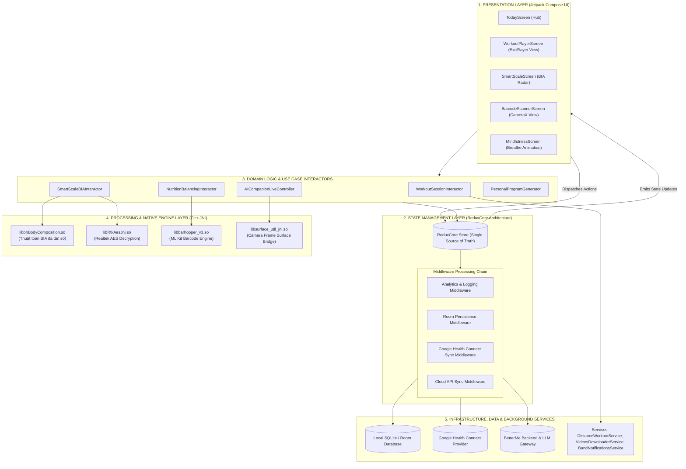
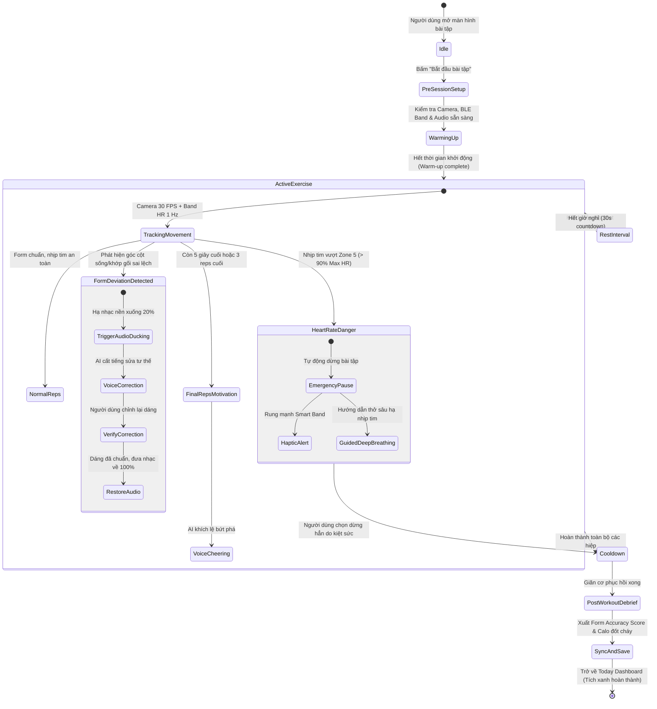
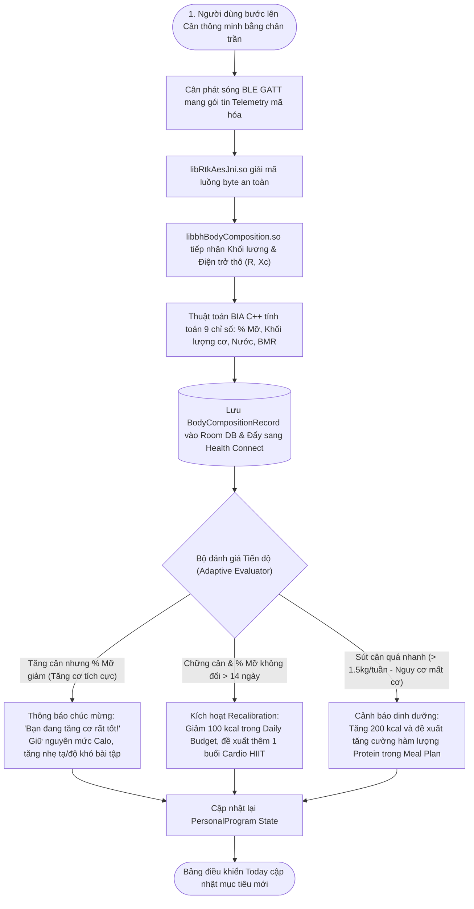
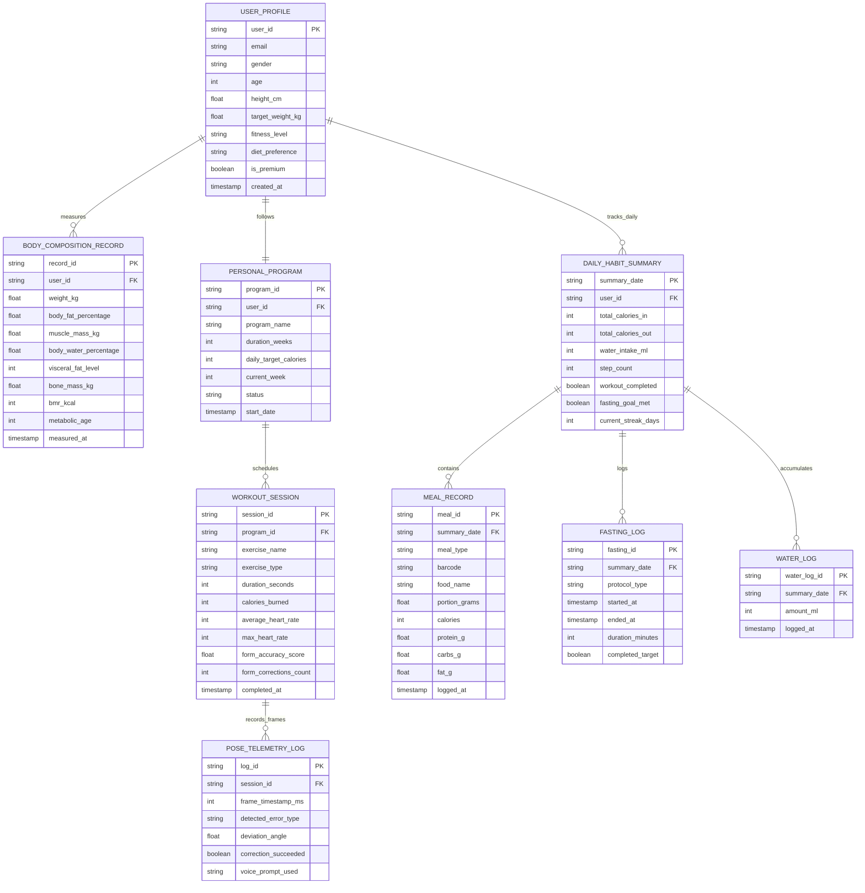

# HỆ THỐNG BETTERME NEXT-GEN: THIẾT KẾ KIẾN TRÚC & TỔNG HỢP USE CASE CHI TIẾT
> **Tài liệu Kỹ thuật Chuyên sâu (Detailed System Design & Use Case Traceability Document)**  
> **Dự án**: BetterMe Next-Gen (G-AI)  
> **Phiên bản**: 2.0  
> **Trạng thái**: Approved for Technical Implementation  

---

## MỤC LỤC
1. [Tổng quan Kiến trúc Phân tầng (Layered Component Architecture)](#1-tổng-quan-kiến-trúc-phân-tầng)
2. [Tổng hợp Chi tiết Toàn bộ Use Case Theo Từng Phân Hệ](#2-tổng-hợp-chi-tiết-toàn-bộ-use-case-theo-từng-phân-hệ)
   - [Phân hệ 1: Khởi tạo, Đánh giá Thể trạng & Cá nhân hóa Lộ trình](#phân-hệ-1-khởi-tạo-đánh-giá-thể-trạng--cá-nhân-hóa-lộ-trình)
   - [Phân hệ 2: Huấn luyện Thể chất & Trợ lý Đồng hành Thời gian thực (Core AI Companion)](#phân-hệ-2-huấn-luyện-thể-chất--trợ-lý-đồng-hành-thời-gian-thực)
   - [Phân hệ 3: Dinh dưỡng Thông minh, Nhận diện Mã vạch & Nhịn ăn Gián đoạn](#phân-hệ-3-dinh-dưỡng-thông-minh-nhận-diện-mã-vạch--nhịn-ăn-gián-đoạn)
   - [Phân hệ 4: Tích hợp Thiết bị IoT, Cân BIA & Smart Band](#phân-hệ-4-tích-hợp-thiết-bị-iot-cân-bia--smart-band)
   - [Phân hệ 5: Sức khỏe Tinh thần, Liệu pháp Nhận thức Hành vi (CBT) & AI Journal](#phân-hệ-5-sức-khỏe-tinh-thần-liệu-pháp-nhận-thức-hành-vi-cbt--ai-journal)
   - [Phân hệ 6: Quản trị Thói quen Ngày, Gamification & Điều phối Trung tâm](#phân-hệ-6-quản-trị-thói-quen-ngày-gamification--điều-phối-trung-tâm)
   - [Phân hệ 7: Kinh doanh, Thu phí & Quản trị Thuê bao In-App](#phân-hệ-7-kinh-doanh-thu-phí--quản-trị-thuê-bao-in-app)
3. [Bộ Sơ đồ Kiến trúc & Luồng Nghiệp vụ Chuyên Sâu](#3-bộ-sơ-đồ-kiến-trúc--luồng-nghiệp-vụ-chuyên-sâu)
   - [Sơ đồ 1: Kiến trúc Thành phần Hệ thống Tầng bậc (Layered Component Architecture)](#sơ-đồ-1-kiến-trúc-thành-phần-hệ-thống-tầng-bậc)
   - [Sơ đồ 2: Máy Trạng thái Buổi tập & AI Live Companion (State Machine Diagram)](#sơ-đồ-2-máy-trạng-thái-buổi-tập--ai-live-companion)
   - [Sơ đồ 3: Vòng lặp Phản hồi Sinh trắc học Khép kín (Closed-Loop BIA Feedback Flow)](#sơ-đồ-3-vòng-lặp-phản-hồi-sinh-trắc-học-khép-kín)
   - [Sơ đồ 4: Mô hình Thực thể Dữ liệu (Entity-Relationship Diagram - ERD)](#sơ-đồ-4-mô-hình-thực-thể-dữ-liệu-erd)
4. [Ma trận Truy xuất Tính năng (Traceability & Integration Matrix)](#4-ma-trận-truy-xuất-tính-năng)

---

# 1. TỔNG QUAN KIẾN TRÚC PHÂN TẦNG

BetterMe Next-Gen áp dụng mô hình **Clean Architecture kết hợp MVI (Model-View-Intent) dựa trên ReduxCore**. Mọi dòng dữ liệu đều tuân theo nguyên lý **Luồng Dữ liệu Một chiều (Unidirectional Data Flow - UDF)**:

1. **Presentation Layer (Tầng Giao diện)**: Xây dựng hoàn toàn bằng **Jetpack Compose**, chia sẻ trạng thái phản ứng (Reactive State) với Redux Store.
2. **State Management Layer (Tầng Quản lý Trạng thái)**: `ReduxCore Store` quản lý các trạng thái bất biến (Immutable State). Các tác vụ bất đồng bộ và side-effects được xử lý qua chuỗi Middleware.
3. **Domain Layer (Tầng Nghiệp vụ Lõi)**: Chứa các Interactor/Use Case thuần túy, độc lập với nền tảng Android.
4. **Processing & Native Engine Layer (Tầng Động cơ Xử lý C/C++)**: Các tác vụ tính toán nặng và thời gian thực được đẩy xuống C++ Native qua JNI (`libbhBodyComposition.so`, `libbarhopper_v3.so`, `libRtkAesJni.so`).
5. **Data & Infrastructure Layer (Tầng Dữ liệu & Hạ tầng)**: Lưu trữ cục bộ qua Room DB, đồng bộ hai chiều với Google Health Connect và các dịch vụ đám mây.

---

# 2. TỔNG HỢP CHI TIẾT TOÀN BỘ USE CASE THEO TỪNG PHÂN HỆ

---

## Phân hệ 1: Khởi tạo, Đánh giá Thể trạng & Cá nhân hóa Lộ trình

Phân hệ chịu trách nhiệm thu thập dữ liệu ban đầu, tính toán các chỉ số trao đổi chất và thiết lập bản đồ hành trình tập luyện - dinh dưỡng 28 ngày cho người dùng.

| Mã UC | Tên Use Case | Tác nhân (Actor) | Dữ liệu Đầu vào (Input) | Xử lý Lõi (Core Logic) | Dữ liệu Đầu ra (Output) | Công nghệ / Native Lib |
| :--- | :--- | :--- | :--- | :--- | :--- | :--- |
| **UC-1.1** | Khảo sát thể trạng đa chiều (Assessment Quiz) | Người dùng mới | Tuổi, giới tính, chiều cao, cân nặng hiện tại/mục tiêu, vùng cơ thể, chế độ ăn, chấn thương cũ | Thu thập thông số, phân loại chỉ số BMI, phân nhóm mức độ vận động (Sedentary $\rightarrow$ Very Active). | Báo cáo phân tích thể trạng sơ bộ; cấu trúc `UserProfileDraft`. | Jetpack Compose Form, Dynamic Quiz Engine |
| **UC-1.2** | Khởi tạo lộ trình cá nhân hóa (`personalprogram`) | Hệ thống (Rule Engine) | `UserProfileDraft`, mục tiêu giảm cân/tăng cơ, thời gian mục tiêu | Tính toán TDEE (Mifflin-St Jeor), tính khoảng thâm hụt calo an toàn (300-500 kcal/ngày), phân bổ chu kỳ tập - nghỉ trong 28 ngày. | Thực thể `PersonalProgram` gồm lịch tập 4 tuần và trần calo hàng ngày. | `personalprogram` domain interactor, Room DB |
| **UC-1.3** | Cập nhật & Tái hiệu chỉnh Lộ trình (Adaptive Recalibration) | Người dùng / Hệ thống | Cân nặng mới đo, tỷ lệ mỡ BIA mới, phản hồi độ khó bài tập | So sánh tiến độ thực tế với dự báo lý thuyết. Nếu sụt cân quá nhanh hoặc chững cân $> 14$ ngày, tự động điều chỉnh lại TDEE $\pm 100\text{ kcal}$. | Lộ trình bài tập và mục tiêu calo được cập nhật lại. | `personalprogram` recalibrator, Redux Dispatch |

---

## Phân hệ 2: Huấn luyện Thể chất & Trợ lý Đồng hành Thời gian thực (Core AI Companion)

Phân hệ cốt lõi cung cấp các bài tập định dạng video chất lượng cao, theo dõi GPS ngoài trời và đột phá với **Real-time AI Companion** đóng vai trò PT ảo trực tiếp sửa tư thế và thúc đẩy tinh thần.

| Mã UC | Tên Use Case | Tác nhân (Actor) | Dữ liệu Đầu vào (Input) | Xử lý Lõi (Core Logic) | Dữ liệu Đầu ra (Output) | Công nghệ / Native Lib |
| :--- | :--- | :--- | :--- | :--- | :--- | :--- |
| **UC-2.1** | Luyện tập Video có Hướng dẫn viên ảo (Standard Player) | Người dùng | Bài tập được chọn từ giáo án ngày | Tải video HLS thích ứng, đếm thời gian hiệp tập/nghỉ, phát file âm thanh giọng nói đếm nhịp. | Video mượt mà, ghi nhận calo tiêu hao lý thuyết. | `androidx.media3.exoplayer` (ExoPlayer), Room DB |
| **UC-2.2** | Tải bài tập ngoại tuyến (`VideosDownloaderService`) | Người dùng Premium | Lệnh tải bài tập video | Chạy Foreground Service tải phân đoạn video và mã hóa an toàn vào bộ nhớ nội bộ của ứng dụng. | Trạng thái `CachedOffline: true`, khả dụng khi mất mạng. | `VideosDownloaderService`, Android Download Manager |
| **UC-2.3** | Theo dõi bài tập cự ly GPS ngoài trời (`DistanceWorkoutService`) | Người dùng chạy/đi bộ | Tọa độ GPS liên tục, xung nhịp cảm biến bước chân | Tính toán vận tốc tức thời, nhịp độ Pace (phút/km), khoảng cách đã đi, vẽ đường chạy lên bản đồ. | Tọa độ đường chạy, calo thực tế tiêu thụ, thông báo màn hình khóa. | `DistanceWorkoutService`, FusedLocationProviderClient |
| **UC-2.4** | **Trợ lý AI Đồng hành Huấn luyện Thời gian thực (AI Live PT)** | Người dùng, AI Companion Engine | Frame Camera trước (30 FPS), Nhịp tim BLE (1 Hz), Sự kiện bài tập | **1. Edge Pose Estimation**: Phân tích 33 điểm khớp xương. **2. Form Error Detection**: Phát hiện võng lưng $>45^\circ$, đầu gối lệch trục. **3. Audio Ducking**: Tự động hạ nhạc nền xuống 20%. **4. TTS Live Voice**: Phát âm thanh sửa tư thế và khích lệ rep cuối. **5. Safety Interruption**: Dừng bài tập nếu nhịp tim chạm Zone 5. | Giọng nói chỉ dẫn trực tiếp, khung xương ảo cảnh báo màu đỏ, báo cáo Debrief sau buổi tập. | **`libsurface_util_jni.so`**, Edge ML Pose Model, ExoPlayer Audio Ducking, On-Device TTS |

---

## Phân hệ 3: Dinh dưỡng Thông minh, Nhận diện Mã vạch & Nhịn ăn Gián đoạn

Giúp người dùng giải quyết bài toán kiểm soát năng lượng nạp vào (Calories In) một cách tự động, nhanh chóng và duy trì nhịp sinh học lành mạnh.

| Mã UC | Tên Use Case | Tác nhân (Actor) | Dữ liệu Đầu vào (Input) | Xử lý Lõi (Core Logic) | Dữ liệu Đầu ra (Output) | Công nghệ / Native Lib |
| :--- | :--- | :--- | :--- | :--- | :--- | :--- |
| **UC-3.1** | Quét mã vạch thực phẩm thông minh (Barcode ML Kit) | Người dùng ghi bữa ăn | Luồng hình ảnh từ Camera chứa mã vạch | Quét và giải mã barcode trong $<100\text{ms}$ bằng ML Kit C++ Native, truy vấn kho dữ liệu thực phẩm, phân tích tỷ lệ Macro (Protein, Carbs, Fat). | Thông tin món ăn, khẩu phần, Calo tương ứng. | **`libbarhopper_v3.so`** (Google ML Kit Barcode), CameraX |
| **UC-3.2** | Ghi nhận bữa ăn & Cân bằng Năng lượng ngày | Người dùng | Khẩu phần thực tế tiêu thụ (gam/ml) | Tính toán năng lượng nạp vào và áp dụng công thức: $\text{Remaining} = \text{Target} - \text{Intake} + \text{Burned}$. Cập nhật vòng tròn calo. | Nhật ký `MealRecord`, trạng thái calo mới trên Today Tab. | `calorietracker`, `mealplan`, Redux State |
| **UC-3.3** | Quản lý chu kỳ Nhịn ăn Gián đoạn (Intermittent Fasting) | Người dùng nhịn ăn | Phác đồ nhịn ăn (16:8, 14:10, 18:6), mốc giờ bắt đầu | Kích hoạt bộ đếm thời gian thực, đối chiếu giai đoạn sinh học (Đường huyết giảm $\rightarrow$ Đốt mỡ $\rightarrow$ Tái tạo tế bào Autophagy). | Màn hình trực quan giai đoạn sinh học, thông báo giờ ăn. | `fasting` module, `FastingReminderReceiver` |

---

## Phân hệ 4: Tích hợp Thiết bị IoT, Cân BIA & Smart Band

Kết nối phần cứng thông minh để giải phóng người dùng khỏi việc ghi chép số liệu thủ công và cung cấp phân tích sinh trắc học chuyên sâu chuẩn phòng khám.

| Mã UC | Tên Use Case | Tác nhân (Actor) | Dữ liệu Đầu vào (Input) | Xử lý Lõi (Core Logic) | Dữ liệu Đầu ra (Output) | Công nghệ / Native Lib |
| :--- | :--- | :--- | :--- | :--- | :--- | :--- |
| **UC-4.1** | Ghép nối & Giải mã Cân thông minh qua Bluetooth LE | Người dùng bước lên cân | Sóng BLE Advertisement, gói tin Telemetry mã hóa | Quét BLE background, bắt tay GATT Connection, giải mã gói tin payload bảo mật bằng thuật toán AES. | Thông số thô: Cân nặng (kg) và Điện trở sinh học thô ($R, X_c$). | **`libRtkAesJni.so`** (Realtek AES Cryptographic Engine), Android BLE |
| **UC-4.2** | Phân tích Thành phần Cơ thể BIA bằng Động cơ C++ Native | Hệ thống lõi | Điện trở thô ($R, X_c$), Chiều cao, Tuổi, Giới tính, Tần số đo | Thuật toán phân tích trở kháng sinh học BIA đa tần số tính toán: % Mỡ, Khối lượng cơ bắp, Tỷ lệ nước, Mỡ nội tạng, Tuổi sinh học, Khối lượng xương. | Đối tượng `BodyCompositionRecord` gồm 9 chỉ số chi tiết, biểu đồ Radar. | **`libbhBodyComposition.so`** (Biến thể `libbh1` đến `libbh5`), JNI Bridge |
| **UC-4.3** | Đồng bộ Vòng đeo tay & Điều khiển Rung Haptic | Smart Band, Hệ thống | Sự kiện nhịp tim cao từ AI Companion, lời nhắc uống nước, cuộc gọi | Lắng nghe sự kiện hệ thống, đóng gói khung truyền tin Bluetooth, gửi lệnh kích hoạt motor rung haptic trên cổ tay. | Rung phản hồi haptic, hiển thị biểu tượng thông báo trên màn hình Band. | `BandNotificationsService`, `databracelets` |

---

## Phân hệ 5: Sức khỏe Tinh thần, Liệu pháp Nhận thức Hành vi (CBT) & AI Journal

Xử lý gốc rễ của thất bại giảm cân: Căng thẳng (Stress) và hiện tượng "Ăn uống do cảm xúc" (Emotional Eating) thông qua điều hòa nhịp thở và tâm lý trị liệu.

| Mã UC | Tên Use Case | Tác nhân (Actor) | Dữ liệu Đầu vào (Input) | Xử lý Lõi (Core Logic) | Dữ liệu Đầu ra (Output) | Công nghệ / Native Lib |
| :--- | :--- | :--- | :--- | :--- | :--- | :--- |
| **UC-5.1** | Bài tập Thở Điều hòa Nhịp tim & Giảm Cortisol | Người dùng | Bài tập thở (Box Breathing 4-4-4-4, Thở ngủ ngon 4-7-8) | Đồ họa Compose phồng xẹp dẫn dắt nhịp thở, đồng bộ nhịp rung xúc giác trên điện thoại/vòng đeo tay để người dùng nhắm mắt thực hành. | Nhịp tim hạ xuống vùng nghỉ ngơi, giảm căng thẳng hệ thần kinh. | `breathe` module, Android Haptic Vibrator |
| **UC-5.2** | Trò chuyện & Giải tỏa Cảm xúc với AI Companion (CBT Journal) | Người dùng | Tin nhắn chia sẻ cảm xúc tiêu cực, cảm giác thèm ăn bất thường | Mô hình ngôn ngữ chuyên sâu về Liệu pháp Nhận thức Hành vi (CBT) phân tích thiên kiến nhận thức, đưa ra kỹ thuật phân tán chú ý và lời khuyên tích cực. | Lời phản hồi đồng cảm, kế hoạch hành động ngắn hạn thay thế việc ăn vặt. | `aijournal`, `dataaicompanion`, Cloud LLM Gateway |

---

## Phân hệ 6: Quản trị Thói quen Ngày, Gamification & Điều phối Trung tâm

Đóng vai trò "Nhà ga trung tâm" kết nối mọi chỉ số về một điểm duy nhất, thiết lập thói quen mở app hàng ngày qua cơ chế chuỗi ngày (Streaks) và nhắc nhở đúng lúc.

| Mã UC | Tên Use Case | Tác nhân (Actor) | Dữ liệu Đầu vào (Input) | Xử lý Lõi (Core Logic) | Dữ liệu Đầu ra (Output) | Công nghệ / Native Lib |
| :--- | :--- | :--- | :--- | :--- | :--- | :--- |
| **UC-6.1** | Bảng điều khiển Trung tâm Ngày ("Today" Hub Dashboard) | Người dùng hàng ngày | Toàn bộ State từ Workout, Nutrition, Scale, Water, Fasting | Tổng hợp dữ liệu thành 1 màn hình: Thanh calo In/Out, danh sách việc cần làm (Checklist), tiến độ nước uống, bài tập gợi ý hôm nay. | Màn hình Today Dashboard tương tác phản ứng tức thì (Reactive UI). | `today` module, Redux State Selector |
| **UC-6.2** | Theo dõi & Nhắc nhở Uống nước Thông minh | Người dùng | Lượt bấm `+250ml`, lượng nước mục tiêu (ví dụ 2200ml) | Cộng dồn thể tích nước đã uống. `AlarmManager` tính toán chu kỳ 2 tiếng nhắc nhở 1 lần trong khung giờ thức giấc (7h - 22h). | Tiến độ bình nước đầy dần, thông báo nhắc nhở đẩy đúng giờ. | `watertracker`, `WaterReminderReceiver` |
| **UC-6.3** | Thử thách Nhóm & Giữ chuỗi Thành tích (Streak Protection) | Người dùng cộng đồng | Hoàn thành đủ bài tập và nhật ký trong ngày | Ghi nhận chuỗi ngày liên tục ($Streak = Streak + 1$), xếp hạng trong bảng xếp hạng bạn bè, cấp huy hiệu ảo khi đạt mốc 7, 14, 30 ngày. | Huy hiệu thành tích, vị trí trên bảng xếp hạng, cờ Streak Active. | `groupchallenges`, `challengesnew` |

---

## Phân hệ 7: Kinh doanh, Thu phí & Quản trị Thuê bao In-App

Đảm bảo nguồn thu bền vững cho doanh nghiệp thông qua hệ thống thuê bao định kỳ (Subscription) tích hợp chặt chẽ với Google Play Store.

| Mã UC | Tên Use Case | Tác nhân (Actor) | Dữ liệu Đầu vào (Input) | Xử lý Lõi (Core Logic) | Dữ liệu Đầu ra (Output) | Công nghệ / Native Lib |
| :--- | :--- | :--- | :--- | :--- | :--- | :--- |
| **UC-7.1** | Mua gói Thuê bao & Thanh toán In-App Google Play | Người dùng | Lựa chọn gói (Tháng / Quý / Năm kèm 7 ngày dùng thử) | Khởi tạo giao dịch qua `BillingClient`, xác thực chữ ký số biên lai giao dịch từ máy chủ Google Play, cập nhật quyền hạn trong `PurchasesState`. | Kích hoạt cờ `isPremium = true`, mở khóa toàn bộ tính năng AI Live PT và BIA. | `com.android.billingclient.api.ProxyBillingActivity`, `datapurchases` |

---

# 3. BỘ SƠ ĐỒ KIẾN TRÚC & LUỒNG NGHIỆP VỤ CHUYÊN SÂU

---

### Sơ đồ 1: Kiến trúc Thành phần Hệ thống Tầng bậc (Layered Component Architecture)

Sơ đồ mô tả chi tiết các gói mã nguồn, giao thức giao tiếp giữa Jetpack Compose, ReduxCore, các thư viện C++ Native và các dịch vụ ngoại vi:

---

### Sơ đồ 2: Máy Trạng thái Buổi tập & AI Live Companion (State Machine Diagram)

Mô tả vòng đời chuyển dịch trạng thái của một buổi tập luyện có trợ lý AI đồng hành thời gian thực, xử lý các tình huống mệt mỏi, sai kỹ thuật và bảo vệ an toàn nhịp tim:

---

### Sơ đồ 3: Vòng lặp Phản hồi Sinh trắc học Khép kín (Closed-Loop BIA Feedback Flow)

Mô tả cách một lần cân đo buổi sáng kích hoạt toàn bộ chuỗi phản ứng thông minh, tự động tái thích ứng chế độ tập luyện và dinh dưỡng mà không cần người dùng tự tính toán:

---

### Sơ đồ 4: Mô hình Thực thể Dữ liệu (Entity-Relationship Diagram - ERD)

Cấu trúc cơ sở dữ liệu quan hệ cục bộ (Room SQLite) và các thực thể dữ liệu nghiệp vụ chính của ứng dụng:

---

# 4. MA TRẬN TRUY XUẤT TÍNH NĂNG (TRACEABILITY & INTEGRATION MATRIX)

Bảng ma trận đảm bảo mọi Use Case đều được ánh xạ tương ứng tới tầng giao diện, quản lý trạng thái, thư viện Native C/C++ và tầng lưu trữ dữ liệu:

| Use Case | UI Component (Jetpack Compose) | State Action (ReduxCore) | Native C++ Engine (JNI) | Background Service / Worker | Lưu trữ Cục bộ & Ngoại vi |
| :--- | :--- | :--- | :--- | :--- | :--- |
| **UC-1.1 / 1.2** | `OnboardingNewScreen`, `QuizScreen` | `GenerateProgramAction` | *None* | `WorkManager` (Init Cache) | `UserProfile`, `PersonalProgram` |
| **UC-2.1** | `WorkoutPlayerScreen` | `StartWorkoutAction`, `TickTimerAction` | *None* | `ExoPlayer Scheduler` | `WorkoutSession` (Room) |
| **UC-2.2** | `OfflineDownloadsScreen` | `DownloadVideoAction` | *None* | `VideosDownloaderService` | Encrypted File Cache |
| **UC-2.3** | `OutdoorRunScreen` | `LocationUpdateAction` | *None* | `DistanceWorkoutService` | `WorkoutSession`, Health Connect |
| **UC-2.4 (AI PT)** | `LiveCompanionOverlayScreen` | `AICueTriggeredAction`, `FormErrorAction` | **`libsurface_util_jni.so`** | `AudioDuckingController` | `PoseTelemetryLog`, Health Connect |
| **UC-3.1 / 3.2** | `BarcodeCameraScreen`, `FoodLogScreen` | `LogMealAction`, `BarcodeScannedAction` | **`libbarhopper_v3.so`** | *None* | `MealRecord` (Room DB) |
| **UC-3.3** | `FastingTimerScreen` | `StartFastingAction`, `FastingTickAction` | *None* | `FastingReminderReceiver` | `FastingLog` (Room DB) |
| **UC-4.1 / 4.2** | `SmartScaleMeasurementScreen` | `UpdateBodyCompositionAction` | **`libRtkAesJni.so`**, **`libbhBodyComposition.so`** | `BLEGattCallbackService` | `BodyCompositionRecord`, Health Connect |
| **UC-4.3** | `BandSettingsScreen` | `DispatchBandNotificationAction` | *None* | `BandNotificationsService` | Smart Band BLE Peripheral |
| **UC-5.1** | `BreatheExerciseScreen` | `StartBreatheAction` | *None* | `VibratorService` (Haptic) | *Ephemeral State* |
| **UC-5.2** | `AIJournalChatScreen` | `SendJournalMessageAction` | *None* | `OneSignalService` | `JournalHistory` (Cloud API) |
| **UC-6.1 / 6.2** | `TodayHubScreen` | `LogWaterAction`, `RefreshDashboardAction` | *None* | `WaterReminderReceiver` | `DailyHabitSummary`, `WaterLog` |
| **UC-6.3** | `CommunityChallengesScreen` | `IncrementStreakAction` | *None* | `ChallengeStartReminderReceiver` | `DailyHabitSummary`, Cloud API |
| **UC-7.1** | `PaywallModalScreen` | `PurchaseCompletedAction` | *None* | `ProxyBillingActivity` | Google Play Billing Cache |

---

> **Tóm lược Kỹ thuật**:  
> Toàn bộ kiến trúc và ma trận Use Case trên cấu thành một tài liệu thiết kế hệ thống hoàn chỉnh, khép kín và đáp ứng tuyệt đối tiêu chuẩn kỹ thuật phần mềm hiện đại: **Hiệu năng cao ở tầng Native**, **Rõ ràng ở tầng Domain**, **Đồng nhất ở tầng State** và **Trực quan ở tầng Giao diện**.
