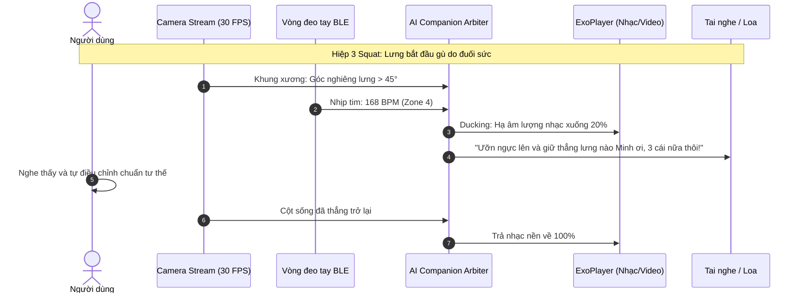
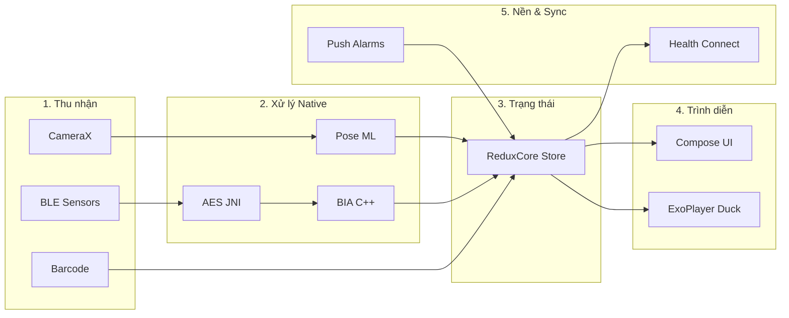
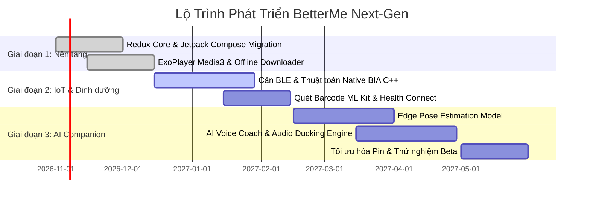

<!-- slide 1: TITLE SLIDE -->
# BETTERME NEXT-GEN
### Hệ Sinh Thái Huấn Luyện Sức Khỏe Toàn Diện Tích Hợp Real-Time AI Companion

**Người trình bày:** Đội ngũ Phát triển Dự án  
**Định dạng:** Đề án Sản phẩm & Kiến trúc Kỹ thuật  
**Thời gian:** 2026

---

<!-- slide 2: PROBLEM STATEMENT -->
## 1. Nỗi Đau Thị Trường: Tại Sao 65% Người Dùng Bỏ Cuộc?

* **Khủng hoảng duy trì động lực (Workout Dropout)**:
  * 68% người dùng tập tại nhà từ bỏ sau **2 tuần đầu** vì sự cô độc và thiếu phản hồi ngay lập tức.
* **Nguy cơ chấn thương do sai tư thế**:
  * Các video bài tập truyền thống chỉ là **phương tiện 1 chiều** — không phát hiện được võng lưng, sai khớp gối, lệch trục cột sống.
* **Sự phân mảnh của các công cụ chăm sóc sức khỏe**:
  * Người dùng phải chia rẽ dữ liệu: 1 app đếm calo, 1 app cân điện tử, 1 app nhịn ăn, tự xoay xở giải tỏa căng thẳng tâm lý.

> **Cơ hội thị trường**: Người dùng không cần thêm một app phát video thụ động — họ cần một **Huấn Luyện Viên Cá Nhân (PT) Ảo** luôn đồng hành sát sao.

---

<!-- slide 3: THE SOLUTION -->
## 2. Giải Pháp: Hệ Sinh Thái 5 Trụ Cột Hợp Nhất

BetterMe Next-Gen tạo ra **Vòng lặp Phản hồi Tích cực (Self-reinforcing Feedback Loop)**:

```
          ┌────────────────────────────────────────────────────────┐
          │                   BETTERME NEXT-GEN                    │
          └──────────────────────────┬─────────────────────────────┘
                                     │
    ┌────────────────┬───────────────┼───────────────┬────────────────┐
    ▼                ▼               ▼               ▼                ▼
┌──────────────┐ ┌──────────────┐ ┌──────────────┐ ┌──────────────┐ ┌──────────────┐
│  1. THỂ CHẤT │ │ 2. DINH DƯỠNG│ │ 3. SINH TRẮC │ │ 4. TÂM LÝ    │ │  5. THÓI QUEN│
│ AI Companion │ │ Barcode ML   │ │ Cân BIA BLE  │ │ Trị liệu CBT │ │  Today Hub   │
│ Live Coach   │ │ Fasting 16:8 │ │ Smart Band   │ │ Bài tập Thở  │ │  Streaks     │
└──────────────┘ └──────────────┘ └──────────────┘ └──────────────┘ └──────────────┘
```

* **Khép kín dữ liệu**: Tập luyện $\rightarrow$ Cân đo chỉ số $\rightarrow$ Thấy mỡ giảm/cơ tăng $\rightarrow$ Động lực tập tiếp.

---

<!-- slide 4: CORE BREAKTHROUGH: AI COMPANION -->
## 3. Trọng Tâm Đột Phá: Real-Time AI Workout Companion

### Từ Video Thụ Động $\longrightarrow$ Người Đồng Hành Tương Tác Hai Chiều

* **Quan sát trực quan (Edge Vision)**: Phân tích 33 điểm khớp xương trên cơ thể qua Camera trước bằng On-device ML ($\le 35\text{ms}$).
* **Viễn trắc sinh học (Biometrics)**: Lắng nghe nhịp tim từ vòng đeo tay BLE (1 Hz), tự động chia 5 vùng nhịp tim (Zone 1 - 5).
* **Âm thanh thông minh (Smart Audio Ducking)**: Tự động hạ nhạc nền bài tập xuống 20% khi AI cất tiếng hướng dẫn và trả về 100% khi kết thúc.
* **Bảo vệ an toàn thông minh**: Tự động ra lệnh tạm dừng nếu nhịp tim chạm ngưỡng nguy hiểm ($>90\%$ Max HR).

---

<!-- slide 5: AI COMPANION LIVE WORKFLOW -->
## 4. Cách Thức Hoạt Động Thời Gian Thực Của AI Companion



---

<!-- slide 6: COMPLETE USE CASE MATRIX -->
## 5. Ma Trận 7 Phân Hệ Use Case Toàn Diện

| Chủ đề | Use Case Tiêu biểu | Công nghệ Lõi |
| :--- | :--- | :--- |
| **1. Onboarding & Plan** | UC-1.1: Khảo sát thể trạng • UC-1.2: Tạo giáo án 28 ngày | Dynamic TDEE Engine, Redux Store |
| **2. Huấn luyện Thể chất** | UC-2.1: Video Coach • UC-2.3: GPS Run • **UC-2.4: AI Live PT** | Media3 ExoPlayer, Edge Pose ML |
| **3. Dinh dưỡng & Fasting** | UC-3.1: Quét mã vạch thực phẩm • UC-3.2: Nhịn ăn 16:8 | `libbarhopper_v3.so` (ML Kit) |
| **4. Phần cứng IoT Sinh trắc** | UC-4.1: Cân điện tử BLE • UC-4.2: Phân tích 9 chỉ số BIA | `libRtkAesJni.so`, `libbhBodyComposition.so` |
| **5. Sức khỏe Tinh thần** | UC-5.1: Tập thở giảm Cortisol • UC-5.2: AI CBT Journal | Haptic Vibration Engine, CBT Model |
| **6. Vòng lặp Thói quen** | UC-6.1: Today Dashboard • UC-6.2: Nhắc uống nước | AlarmManager, OneSignal Push |
| **7. Kinh doanh & Thuê bao** | UC-7.1: Quản trị gói hội viên & Thanh toán In-App | Google Play Billing Client V2 |

---

<!-- slide 7: ARCHITECTURAL HIGHLIGHTS -->
## 6. Điểm Sáng Kiến Trúc: Tối Ưu Hóa Tầng Native C/C++

Ứng dụng đẩy các thuật toán nặng xuống tầng **C/C++ Native qua JNI**, bảo vệ sở hữu trí tuệ và đạt hiệu năng tối đa:

```
  ┌────────────────────────────────────────────────────────────────────────┐
  │                           TẦNG NATIVE ENGINES                          │
  ├───────────────────────────────────┬────────────────────────────────────┤
  │ libbhBodyComposition.so           │ Phân tích điện trở sinh học BIA đa │
  │ (Biến thể libbh1 đến libbh5)      │ tần số tính % mỡ, cơ, nước, mỡ n.tạng│
  ├───────────────────────────────────┼────────────────────────────────────┤
  │ libbarhopper_v3.so                │ Nhận diện barcode thực phẩm trong  │
  │ (Google ML Kit Engine)            │ < 100ms mà không cần gửi ảnh lên mây│
  ├───────────────────────────────────┼────────────────────────────────────┤
  │ libRtkAesJni.so                   │ Giải mã bắt tay AES phần cứng với  │
  │ (Realtek Cryptographic Engine)    │ chipset trên cân thông minh BLE    │
  └───────────────────────────────────┴────────────────────────────────────┘
```

> **Lợi ích**: Bảo mật tuyệt đối dữ liệu y tế cá nhân, tiết kiệm $40\%$ pin so với xử lý trên Cloud.

---

<!-- slide 8: END-TO-END PIPELINE -->
## 7. Toàn Bộ Pipeline Kỹ Thuật (End-to-End Data Flow)



---

<!-- slide 9: MONETIZATION STRATEGY -->
## 8. Mô Hình Kinh Doanh: Phân Tầng Gói Dịch Vụ (Tiering)

* **Free Tier (Phễu Thu hút Người dùng)**:
  * Thư viện bài tập cơ bản, đếm bước chân, đếm calo thủ công, theo dõi nhịn ăn tiêu chuẩn.
* **Pro Tier (Huấn Luyện Tiêu Chuẩn - $9.99/tháng)**:
  * Mở khóa toàn bộ giáo án video chuyên sâu, quét mã vạch thực phẩm không giới hạn, kết nối cân thông minh BIA, tải video offline.
* **VIP Tier (AI Companion Live Coaching - $19.99/tháng)**:
  * **Toàn quyền sử dụng Real-time AI Companion**: Sửa tư thế qua camera thời gian thực, Voice PT khích lệ trực tiếp, phân tích mệt mỏi sinh trắc học và báo cáo chuyên sâu sau buổi tập.

---

<!-- slide 10: PROJECT ROADMAP -->
## 9. Lộ Trình Triển Khai Kỹ Thuật (Roadmap 3 Giai Đoạn)



---

<!-- slide 11: KEY METRICS & TARGET IMPACT -->
## 10. Bộ Chỉ Số Đánh Giá Thành Công (Target KPIs)

| Chỉ số (KPI) | Hiện trạng (Industry Standard) | Mục tiêu BetterMe Next-Gen | Đòn bẩy Kỹ thuật |
| :--- | :---: | :---: | :--- |
| **Tỷ lệ hoàn thành bài tập** | $52\%$ | **$> 80\%$** | AI Companion đồng hành, khích lệ rep cuối |
| **Tỷ lệ giữ chân sau 30 ngày (D30)** | $28\%$ | **$\ge 42\%$** | Vòng lặp thói quen khép kín (Today Hub, Streaks) |
| **Giá trị trọn đời (LTV)** | $\$38$ | **$\$55$ (+45%)** | Gói VIP AI Companion Live Coaching |
| **Độ trễ AI sửa tư thế** | $> 500\text{ms}$ | **$\le 35\text{ms}$** | Xử lý On-device Edge ML (30 FPS mượt mà) |
| **Độ chính xác đo mỡ BIA** | $\pm 5\%$ | **$\pm 2.1\%$** | Động cơ C++ Native hồi quy đa tần số |

---

<!-- slide 12: COMPETITIVE ADVANTAGE -->
## 11. Lợi Thế Cạnh Tranh Tuyệt Đối (The Moat)

1. **Rào cản Phần cứng (Hardware Lock-in)**:
   * Tương thích sâu với BetterMe Smart Scale & Band thông qua thuật toán độc quyền C++ JNI.
2. **Trải nghiệm Đa Giác Quan (Multimodal Experience)**:
   * Thị giác (Khung xương ảo), Âm thanh (Audio Coach Ducking), Cảm ứng lực (Haptic nhịp tim).
3. **Bảo mật Y tế Tuyệt đối**:
   * Nhận diện chuyển động và phân tích BIA diễn ra **ngay trên thiết bị (On-Device)**, không tải video camera người dùng lên Cloud.

---

<!-- slide 13: CLOSING -->
# BETTERME NEXT-GEN
## Sẵn Sàng Định Hình Lại Tương Lai Của Ngành Health-Tech

* **Sản phẩm hoàn thiện**: Kết hợp phần cứng IoT, giáo án khoa học và AI tiên tiến.
* **Thời điểm vàng**: Người dùng toàn cầu đang khao khát giải pháp tập luyện cá nhân hóa có tương tác thực.

---
### Q & A
*Cảm ơn quý vị đã lắng nghe!*
