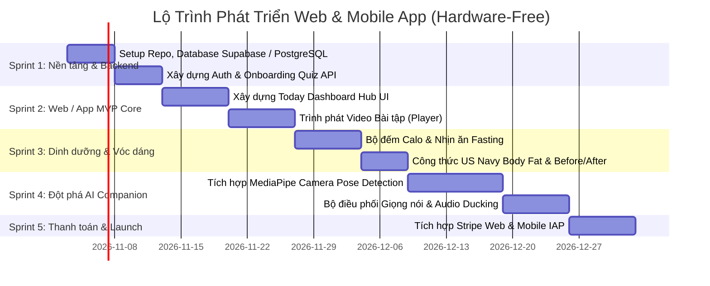

# KẾ HOẠCH BẺ NHỎ & PHÂN TÁCH USE CASE — HỆ THỐNG WEB & APP (HARDWARE-FREE)
> **Dự án**: BetterMe Next-Gen (G-AI)  
> **Kiến trúc**: Web Responsive (Next.js / React) + Mobile App (Flutter / React Native / Android Compose) + Backend AI Service (FastAPI / Node.js)  
> **Đặc điểm**: **100% Thuần Phần Mềm (Software-Only)** — Loại bỏ hoàn toàn phụ thuộc vào phần cứng (không cần cân điện tử, không cần vòng đeo tay BLE).

---

## MỤC LỤC
1. [Lợi thế khi Chuyển sang Nền tảng Thuần Web & App](#1-lợi-thế-khi-chuyển-sang-nền-tảng-thuần-web--app)
2. [Kiến trúc Đồng bộ Đa Nền tảng (Web & Mobile Synchronization)](#2-kiến-trúc-đồng-bộ-đa-nền-tảng)
3. [Danh mục Use Case Tinh gọn cho Web & App](#3-danh-mục-use-case-tinh-gọn-cho-web--app)
   - [Phân hệ 1: Onboarding, Đánh giá Thể trạng & Tạo Lộ trình](#phân-hệ-1-onboarding-đánh-giá-thể-trạng--tạo-lộ-trình)
   - [Phân hệ 2: Huấn luyện Thể chất & AI Live Companion (Webcam & Phone Cam)](#phân-hệ-2-huấn-luyện-thể-chất--ai-live-companion-webcam--phone-cam)
   - [Phân hệ 3: Dinh dưỡng, Ghi nhận Bữa ăn & Nhịn ăn Gián đoạn](#phân-hệ-3-dinh-dưỡng-ghi-nhận-bữa-ăn--nhịn-ăn-gián-đoạn)
   - [Phân hệ 4: Nhật ký Vóc dáng & Ước tính Mỡ cơ thể Thuần Phần mềm](#phân-hệ-4-nhật-ký-vóc-dáng--ước-tính-mỡ-cơ-thể-thuần-phần-mềm)
   - [Phân hệ 5: Sức khỏe Tinh thần (Breathe & CBT AI Companion Chat)](#phân-hệ-5-sức-khỏe-tinh-thần-breathe--cbt-ai-companion-chat)
   - [Phân hệ 6: Today Dashboard & Vòng lặp Thói quen Đa nền tảng](#phân-hệ-6-today-dashboard--vòng-lặp-thói-quen-đa-nền-tảng)
   - [Phân hệ 7: Quản trị Thuê bao & Thanh toán Đa kênh (Web Stripe + Mobile IAP)](#phân-hệ-7-quản-trị-thuê-bao--thanh-toán-đa-kênh-web-stripe--mobile-iap)
4. [Lộ trình Triển khai Code Từng Bước (Development Roadmap)](#4-lộ-trình-triển-khai-code-từng-bước)

---

# 1. LỢI THẾ KHI CHUYỂN SANG NỀN TẢNG THUẦN WEB & APP

1. **Rào cản gia nhập bằng 0 (Zero Hardware Barrier)**:
   * Người dùng không cần phải mua cân điện tử hay vòng đeo tay đắt tiền. Bất kỳ ai có laptop/máy tính bàn (Webcam) hoặc điện thoại thông minh (iOS/Android) đều có thể sử dụng ngay lập tức.
2. **AI Companion thích ứng linh hoạt**:
   * **Trên Web**: Tập luyện trước màn hình lớn (Laptop, PC, Smart TV), Webcam bắt toàn thân góc rộng cực kỳ chính xác.
   * **Trên App**: Tiện lợi khi đi công tác, phòng gym, tập ngoài ban công; sử dụng Camera trước của điện thoại.
3. **Thay thế cảm biến phần cứng bằng giải pháp phần mềm thông minh**:
   * *Thay cho cân BIA*: Đo số đo 3 vòng và áp dụng **Công thức Nhân trắc học US Navy Body Fat** + Album ảnh đối chiếu vóc dáng (Visual Body Progress).
   * *Thay cho vòng đo nhịp tim*: Đo lường mức độ gắng sức chủ quan **RPE Scale (Rate of Perceived Exertion 1-10)** hoặc thuật toán đếm nhịp độ chuyển động để nhận diện mệt mỏi.

---

# 2. KIẾN TRÚC ĐỒNG BỘ ĐA NỀN TẢNG

```
     ┌────────────────────────┐                   ┌────────────────────────┐
     │      WEB PLATFORM      │                   │     MOBILE APP         │
     │  (Next.js / React SPA) │                   │ (Flutter/React Native) │
     │  • Dashboard màn lớn   │                   │ • Tập luyện cơ động    │
     │  • Webcam AI Live PT   │                   │ • Camera Phone AI PT   │
     └───────────┬────────────┘                   └───────────┬────────────┘
                 │                                            │
                 │              GraphQL / REST API            │
                 └────────────────────┬───────────────────────┘
                                      ▼
                        ┌───────────────────────────┐
                        │    BACKEND API & AI CORE  │
                        │    (FastAPI / Node.js)    │
                        │ • User Profile & Program  │
                        │ • Nutrition Database      │
                        │ • LLM Companion (CBT)     │
                        └─────────────┬─────────────┘
                                      ▼
                        ┌───────────────────────────┐
                        │   DATABASE & CLOUD STORAGE│
                        │  (PostgreSQL / Supabase)  │
                        └───────────────────────────┘
```

---

# 3. DANH MỤC USE CASE TINH GỌN CHO WEB & APP

---

## Phân hệ 1: Onboarding, Đánh giá Thể trạng & Tạo Lộ trình

### UC-1.1: Khảo sát Thể trạng Trực quan (Web/App Assessment Wizard)
* **Mục tiêu**: Thu thập thông số người dùng qua giao diện Step-by-step mượt mà trên cả Web và App.
* **Đầu vào**: Tuổi, giới tính, chiều cao, cân nặng hiện tại, cân nặng mục tiêu, các vùng cần thon gọn (Bụng, Đùi, Mông, Lưng), phong cách tập luyện yêu thích, chấn thương cũ.
* **Xử lý**: Validate dữ liệu, tính chỉ số BMI, phân loại trạng thái cân nặng.
* **Đầu ra**: Bản đồ hồ sơ người dùng (`UserProfile`), chuyển tiếp sang màn hình tạo giáo án.

### UC-1.2: Thuật toán Sinh Lộ trình 28 Ngày Cá nhân hóa
* **Mục tiêu**: Tự động tính toán công thức năng lượng và phân bổ lịch tập.
* **Công thức**:
  - $BMR$ (Mifflin-St Jeor): Tính năng lượng trao đổi chất cơ bản.
  - $TDEE = BMR \times \text{Hệ số vận động}$.
  - Calo mục tiêu ngày: $\text{TDEE} - 400\text{ kcal}$ (Giảm mỡ) hoặc $\text{TDEE} + 300\text{ kcal}$ (Tăng cơ).
* **Đầu ra**: Kế hoạch 28 ngày gồm 4 buổi tập/tuần kèm 3 ngày nghỉ, được lưu vào Database và đồng bộ tức thì giữa Web và Mobile.

---

## Phân hệ 2: Huấn luyện Thể chất & AI Live Companion (Webcam & Phone Cam)

### UC-2.1: Trình phát Video Bài tập Tương tác (Video Workout Player)
* **Nền tảng**:
  - **Web**: Trình phát Video HTML5 tùy biến trên màn hình lớn, có phím tắt tiện lợi (Space: Pause, F: Fullscreen).
  - **Mobile**: ExoPlayer / AVPlayer tối ưu hóa bộ đệm mượt mà.
* **Xử lý**: Quản lý chuỗi động tác: Tập 45s $\rightarrow$ Nghỉ 15s $\rightarrow$ Chuyển động tác. Giọng nói Hướng dẫn viên ảo (Audio Coach) đếm nhịp.

### UC-2.2: Trợ lý AI Đồng hành Huấn luyện Thời gian thực (Real-time AI Companion) — *TÍNH NĂNG ĐỘT PHÁ*
* **Cơ chế hoạt động (100% bằng Camera & Micro)**:
  1. **Nhận diện chuyển động (Pose Detection)**:
     - Sử dụng thư viện **MediaPipe Pose** hoặc **TensorFlow.js (MoveNet)** chạy trực tiếp trên trình duyệt Web (Webcam) hoặc Camera điện thoại.
     - Xác định tọa độ 33 điểm khớp xương theo thời gian thực (30 FPS).
  2. **Phân tích kỹ thuật động tác (Form Analysis)**:
     - *Squat*: Tính góc Hông - Gối - Cổ chân. Nếu gối đưa quá mũi chân hoặc chưa gập đủ sâu $\rightarrow$ Nhận diện lỗi.
     - *Plank / Chống đẩy*: Tính góc Cột sống. Nếu võng lưng $> 45^\circ \rightarrow$ Nhận diện lỗi tư thế.
  3. **Tự động đếm Reps chuẩn xác**:
     - Chỉ tính 1 rep khi người dùng thực hiện đủ biên độ chuyển động (ROM - Range of Motion).
  4. **Giọng nói hướng dẫn & Khích lệ (Live Voice PT & Audio Ducking)**:
     - Tự động giảm âm lượng video bài tập khi AI cất tiếng qua Web Audio API hoặc Mobile Audio Manager.
     - AI cất tiếng: *"Giữ thẳng lưng nào Minh ơi, 3 cái nữa thôi!"*.
* **Đầu ra**: Báo cáo tổng kết buổi tập: Điểm chuẩn tư thế (Form Score %), số rep hợp lệ, calo đốt cháy.

---

## Phân hệ 3: Dinh dưỡng, Ghi nhận Bữa ăn & Nhịn ăn Gián đoạn

### UC-3.1: Ghi nhận Bữa ăn & Tra cứu Dinh dưỡng
* **Nền tảng**:
  - **Mobile App**: Bật Camera quét mã vạch bao bì thực phẩm (ML Kit Barcode) $\rightarrow$ Tự động điền thông tin món.
  - **Web**: Ô tìm kiếm thông minh (Smart Search) tra cứu cơ sở dữ liệu thực phẩm (hàng triệu món ăn với đầy đủ Protein, Carbs, Fat, Calo).
* **Xử lý**: Người dùng nhập khẩu phần (gram) $\rightarrow$ Hệ thống tự động tính tổng calo nạp vào và cân bằng với ngân sách ngày.

### UC-3.2: Bộ đếm Nhịn ăn Gián đoạn Đa nền tảng (Intermittent Fasting Tracker)
* **Xử lý**: Đồng hồ đếm ngược chu kỳ 16:8 (hoặc 14:10, 18:6).
* **Đặc điểm**: Trực quan hóa các giai đoạn chuyển hóa sinh học:
  - *Giờ 0 - 4*: Tiêu hóa thức ăn.
  - *Giờ 4 - 12*: Đường huyết hạ, bắt đầu đốt mỡ thừa.
  - *Giờ 12 - 16*: Tái tạo tế bào (Autophagy) và kích hoạt hormone đốt mỡ.
* **Thông báo**: Đẩy Web Push Notification trên trình duyệt và Push Notification trên Mobile khi đến giờ ăn.

---

## Phân hệ 4: Nhật ký Vóc dáng & Ước tính Mỡ cơ thể Thuần Phần mềm

*(Thay thế hoàn toàn cân điện tử phần cứng)*

### UC-4.1: Ước tính % Mỡ Cơ thể bằng Công thức Nhân trắc học US Navy
* **Mục tiêu**: Đo lường tỷ lệ mỡ cơ thể chuẩn xác mà không cần cân đắt tiền.
* **Cách thực hiện**:
  - Người dùng dùng thước dây đo: Vòng cổ, Vòng eo (ngang rốn), và Vòng hông (đối với nữ).
  - Thuật toán US Navy Body Fat Formula tính toán % mỡ cơ thể với sai số chỉ $\pm 1-3\%$ so với phương pháp đo chuyên dụng.
* **Đầu ra**: % Mỡ cơ thể, phân loại thể trạng (Fitness, Athlete, Average, Overweight).

### UC-4.2: Album Nhật ký Vóc dáng Trực quan (Visual Body Progress Journal)
* **Tính năng**:
  - Cho phép chụp hoặc tải ảnh cơ thể theo 3 góc: Chính diện, Nghiêng, Phía sau.
  - Công cụ **So sánh Trước/Sau (Before & After Slider)** giúp người dùng thấy rõ sự thay đổi cơ bắp/vòng eo sau từng tháng tập luyện.
  - Bảo mật tuyệt đối bằng mã hóa ảnh riêng tư (Private Storage).

---

## Phân hệ 5: Sức khỏe Tinh thần (Breathe & CBT AI Companion Chat)

### UC-5.1: Bài tập Thở Trực quan Điều hòa Căng thẳng (Visual Breathwork)
* **Trải nghiệm**:
  - Đồ họa SVG/Canvas phồng lên xẹp xuống theo các phác đồ thở:
    - *Box Breathing (4-4-4-4)*: Giảm căng thẳng tức thì.
    - *4-7-8 Breathing*: Giúp thư giãn và dễ đi vào giấc ngủ.
  - Âm thanh tiếng chuông tĩnh tâm và tiếng gió nhẹ nhàng hướng dẫn nhịp thở.

### UC-5.2: Trò chuyện Trị liệu Tâm lý với AI CBT Companion
* **Mục tiêu**: Giải quyết gốc rễ của việc thèm ăn mất kiểm soát do áp lực công việc (Stress Eating).
* **Tính năng**: Khung chat AI đóng vai trò người bạn thấu hiểu, phân tích cảm xúc tiêu cực và đưa ra lời khuyên thực tế để xoa dịu tâm trạng.

---

## Phân hệ 6: Today Dashboard & Vòng lặp Thói quen Đa nền tảng

### UC-6.1: Bảng Điều khiển Trung tâm Ngày (Today Hub Dashboard)
* **Tính năng**:
  - Vòng tròn Calo hợp nhất: $\text{Còn lại} = \text{Mục tiêu} - \text{Nạp vào} + \text{Tiêu hao}$.
  - Checklist thói quen ngày (Uống nước, tập bài 15 phút, ghi bữa ăn).
  - Đồng bộ trạng thái tức thời qua WebSockets / Server-Sent Events giữa Web và Mobile.

### UC-6.2: Theo dõi Nước uống Tiện lợi (Hydration Tracker)
* **Thao tác**: Chạm nhanh `+250ml` trên cả giao diện Web và App Mobile.

### UC-6.3: Hệ thống Giữ Chuỗi Ngày Liên tục (Streak System)
* **Tác dụng**: Khuyến khích người dùng đăng nhập và hoàn thành ít nhất 1 nhiệm vụ mỗi ngày để giữ lửa thành tích ($Streak + 1$).

---

## Phân hệ 7: Quản trị Thuê bao & Thanh toán Đa kênh

### UC-7.1: Thanh toán Đa nền tảng (Web Stripe & Mobile IAP)
* **Web**: Tích hợp cổng thanh toán quốc tế **Stripe Checkout** (hỗ trợ Visa, Mastercard, Google Pay, Apple Pay trên Web).
* **Mobile App**: Tích hợp **In-App Purchases** (Google Play Billing trên Android, StoreKit trên iOS).
* **Quyền lợi gói VIP**: Mở khóa không giới hạn tính năng AI Live PT qua Camera, toàn bộ giáo án chuyên sâu và thực đơn dinh dưỡng cá nhân.

---

# 4. LỘ TRÌNH TRIỂN KHAI CODE TỪNG BƯỚC (QUICK START ROADMAP)



---

### BƯỚC BẮT ĐẦU NGAY BÂY GIỜ

Để bắt đầu build ngay, chúng ta có thể chọn 1 trong 2 nhánh xuất phát điểm:
1. **Nhánh 1 (Core Web/Mobile Client)**: Tạo khung giao diện Web (Next.js) hoặc Mobile App, code màn hình **Quiz khảo sát thể trạng (UC-1.1)** và **Dashboard (UC-6.1)**.
2. **Nhánh 2 (AI Live Companion Prototype)**: Viết ngay module **MediaPipe Pose Detection** chạy trên Webcam/Camera trình duyệt để thử nghiệm tính năng nhận diện tư thế Squat/Plank và đếm rep tự động!
