# Thiết kế Cơ sở dữ liệu Web G-AI (Sprint 1–3) trên Supabase Postgres

> **Trạng thái:** Proposed (Giai đoạn 1 — Chờ duyệt trước khi viết models & Alembic migrations)  
> **Ngày:** 2026-11-12  
> **Tài liệu liên quan:**
> - [ADR-0001: Sessions & API boundary](../../adr/0001-sessions-and-api-boundary.md)
> - [ADR-0002: Privacy of photo predictions](../../adr/0002-prediction-images-privacy.md)
> - [ADR-0003: Store catalog, login throttling, token revocation](../../adr/0003-catalog-login-throttling-token-revocation.md)
> - [ADR-0004: Supabase Postgres & Private Storage](../../adr/0004-supabase-postgres-and-storage.md)
> - [Lộ trình Sprint 1–5](2026-11-12-sprint-roadmap-design.md)

---

## 1. Tổng quan Quyết định Kiến trúc & Dữ liệu

Các quyết định 1–3 và 7 (Auth env vars, khoá Data API `public` bằng RLS + `REVOKE`, role `postgres` vs `g_ai_runtime`, Supabase Private Storage) được ghi chi tiết trong [ADR-0004](../../adr/0004-supabase-postgres-and-storage.md). Dưới đây là các quyết định thiết kế dữ liệu **4, 5, 6, 8** và quy ước triển khai:

### Quyết định 4: Tiền tệ (Chuyển từ `Float` sang số nguyên đơn vị nhỏ nhất + `currency`)
- **Hiện trạng đã kiểm chứng:** `products.price`, `products.original_price`, `orders.total_amount` đang là `Float`; `orders.items` JSON lưu `unit_price` dạng float ([store.py](../../../apps/backend/app/models/store.py)); `store_catalog.json` có giá `49..129` và `apps/site` hiển thị ký hiệu `$` ([store-api.ts](../../../apps/site/src/lib/store-api.ts)).
- **Quy ước mới:**
  - Mọi giá trị tiền lưu bằng **`BigInteger` đơn vị nhỏ nhất không chia nhỏ được (`*_minor`)** kèm **`currency` (`VARCHAR(3)`, ISO-4217 chữ hoa, kiểm tra bằng `CHECK`)**.
  - **Quy tắc đơn vị nhỏ nhất (khớp Stripe):**
    - Tiền tệ có 2 chữ số thập phân (`USD`): `1.00 USD = 100` (`price_minor = 9900` cho `$99`).
    - Tiền tệ không có đơn vị lẻ (`VND` — zero-decimal currency): `1 VND = 1` (`price_minor = 990000` cho `990,000₫`, **không nhân 100**).
  - Áp dụng đồng nhất cho `products` (`price_minor`, `original_price_minor`, `currency`), `orders` (`total_minor`, `currency`, snapshot `unit_price_minor` trong `items`) và bảng mới `subscriptions` (`amount_minor`, `currency`).
- **Chiến lược migration an toàn:**
  1. Thêm cột `currency` (mặc định tạm theo tiền tệ bán hàng được chốt — xem Câu hỏi mở #1), `price_minor`, `original_price_minor` (nullable), `total_minor` (nullable).
  2. Backfill dữ liệu hiện có trong cùng migration (`ROUND(price * 100)` nếu `'USD'`, hoặc `ROUND(price)` nếu `'VND'`), rồi `SET NOT NULL` cho `price_minor` và `total_minor`.
  3. Cập nhật `store.py`, `catalog.py`, `store_catalog.json`, `schemas/store.py` và `packages/shared-types/api/store.ts`, sau đó drop các cột `Float` cũ (`products.price`, `products.original_price`, `orders.total_amount`) ở cuối bước chuyển đổi (hoặc giữ 1 bản phát hành rồi drop). `downgrade()` quy đổi ngược lại `Float` từ `*_minor` và `currency`.

### Quyết định 5: Thời gian (`TIMESTAMPTZ`) & Định nghĩa "Ngày" theo múi giờ người dùng
- **Lưu trữ thời điểm:** Toàn bộ cột timestamp dùng `DateTime(timezone=True)` (`TIMESTAMPTZ` trong Postgres, lưu UTC).
- **Nơi lưu múi giờ người dùng:** Thêm cột `timezone` (`VARCHAR(64)`, `NOT NULL`, `server_default='Asia/Ho_Chi_Minh'`) vào bảng **`users`** (lưu tên múi giờ IANA như `"Asia/Ho_Chi_Minh"`, `"America/Los_Angeles"`, kiểm chứng ở Pydantic bằng `zoneinfo.available_timezones()`). Đặt ở `users` vì người dùng có thể log `daily_metrics`/`meal_logs` trước hoặc sau khi làm lại quiz.
- **Định nghĩa "Ngày" (`local_date`):**
  - Backend quy đổi thời điểm UTC `TIMESTAMPTZ` sang `ZoneInfo(user.timezone)` để lấy `DATE` địa phương (`local_date`).
  - `daily_metrics.date`: giữ là `local_date` theo múi giờ người dùng tại thời điểm tạo bản ghi (`UNIQUE (user_id, date)`).
  - `meal_logs`: lưu **cả hai** `logged_at` (`TIMESTAMPTZ`, thời điểm thực ăn) và `local_date` (`DATE`, chốt theo `user.timezone` lúc log) — giúp tổng kết calo ngày & `DailyMetric.calories_consumed` không bị nhảy lệch sang ngày khác nếu người dùng đổi múi giờ khi đi công tác/du lịch.
  - **Streak (`UC-6.3`):** Tính từ `daily_metrics` sắp xếp theo `date DESC` đến `today(user.timezone)`. Một ngày được tính đạt chuỗi nếu thỏa điều kiện hoạt động (ví dụ: `calories_burned > 0` hoặc `calories_consumed > 0` hoặc `jsonb_array_length(habits_completed) > 0` hoặc `water_intake_ml >= 500`), tính động qua truy vấn index `(user_id, date)` (có thể lưu thêm cache `current_streak` nếu cần sau này, chưa cần tạo bảng riêng).

### Quyết định 6: Vòng đời dữ liệu nhạy cảm, `ON DELETE`, Retention & Mã hoá `cbt_messages`
- **Thứ tự và hành vi khi xoá tài khoản (`DELETE /api/v1/auth/me`):**
  1. **Trước khi xoá row `users`:** Backend truy vấn toàn bộ `storage_path` trong `progress_photos` và `prediction_jobs` thuộc `user_id` đó (kèm `input_storage_path` và các output paths).
  2. **Xoá trong DB (`ON DELETE CASCADE`):**
     - `daily_metrics`, `workout_logs`, `meal_logs`, `body_measurements`, `progress_photos`, `cbt_sessions` (kéo theo `cbt_messages`), `prediction_jobs`: **`ON DELETE CASCADE`**.
     - **Sửa bất nhất hiện có ở `quiz_assessments` và `personalized_plans`:** Hiện tại trong [quiz.py](../../../apps/backend/app/models/quiz.py) đang để `user_id` là `ON DELETE SET NULL`. Vì các bảng này chứa dữ liệu sinh trắc học (`age`, `height_cm`, `current_weight_kg`, `obstacles`), cần đổi sang **`ON DELETE CASCADE`** (hoặc xoá tường minh trong service xoá tài khoản) để không để lại dữ liệu sức khoẻ mồ côi.
     - **Dữ liệu tài chính/kế toán (`orders`, `subscriptions`):** Giữ `user_id` là **`ON DELETE SET NULL`** (`orders` hiện đã là `SET NULL`). Khi xoá tài khoản, endpoint xoá cần ẩn danh hoá PII (`customer_email`, `customer_name`, `shipping_address`) trên `orders` nếu chính sách yêu cầu, nhưng giữ lại bản ghi giao dịch/trạng thái Stripe cho đối soát kế toán/chargeback.
  3. **Xoá object trên Supabase Storage:** Sau khi transaction DB commit thành công, backend gọi Supabase Storage xoá toàn bộ `storage_path` đã gom ở bước 1. Nếu gọi Storage lỗi tạm thời, ghi nhận vào bảng/log retry dọn rác (hoặc dùng outbox) để bảo đảm không sót ảnh sinh trắc học mồ côi.
- **Dữ liệu sức khoẻ tâm thần (`cbt_messages`):**
  - **Thời hạn lưu (Retention):** Đề xuất lưu mặc định **90 ngày** kể từ `created_at` (hoặc xoá ngay lập tức theo nút "Xoá lịch sử trò chuyện CBT" của người dùng), dọn định kỳ bằng job nền (`DELETE FROM cbt_messages WHERE created_at < NOW() - INTERVAL '90 days'`).
  - **Mã hoá tầng ứng dụng:** **Có — khuyến nghị mã hoá `cbt_messages.content` bằng `AES-256-GCM` (hoặc `Fernet` / `MultiFernet` hỗ trợ xoay khoá)** qua biến `CBT_ENCRYPTION_KEY` chỉ nằm ở backend, lưu vào cột `content_ciphertext` (`BYTEA` trên Postgres / `LargeBinary` trong SQLAlchemy) kèm `key_version` (`SmallInteger`).
  - *Đánh đổi:* Không thể tìm kiếm full-text (`ILIKE` / `tsvector`) bên trong nội dung tin nhắn trên DB; hoàn toàn chấp nhận được vì `cbt_messages` luôn truy vấn theo `(session_id, created_at)` hoặc `(user_id, created_at)`. Đổi lại, rò rỉ dump DB hay nhân viên xem Supabase Studio cũng không đọc được nội dung tâm sự của người dùng.

### Quyết định 8: `food_items` — Danh mục chung, người dùng tự tạo, và chống trùng lặp
- **Mô hình Hybrid (cả hai trong một bảng `food_items`):**
  - `owner_user_id` (`INTEGER NULL`, `FK -> users.id ON DELETE CASCADE`):
    - `NULL` = **danh mục chuẩn toàn hệ thống** (seed món ăn Việt Nam & quốc tế, hoặc đồng bộ từ nguồn chuẩn như USDA/OpenFoodFacts).
    - `<user_id>` = **món ăn do chính người dùng tự tạo** (chỉ user đó thấy khi tìm kiếm cùng với danh mục chuẩn).
- **Chống trùng lặp:**
  - Chuẩn hoá tên món vào cột `canonical_name` (`VARCHAR(200)`) bằng cách bỏ dấu tiếng Việt, lowercase, gộp khoảng trắng (ví dụ `"Phở Bò Tái "` → `"pho bo tai"`).
  - Tạo **2 partial unique index** (hỗ trợ cả Postgres và SQLite 3.8+):
    1. Trên danh mục chuẩn: `UNIQUE (canonical_name) WHERE owner_user_id IS NULL AND is_active = true`.
    2. Trên món riêng của user: `UNIQUE (owner_user_id, canonical_name) WHERE owner_user_id IS NOT NULL AND is_active = true`.
  - Tạo partial unique index cho mã vạch toàn cục (phục vụ Barcode Scanner ở Sprint 5): `UNIQUE (barcode) WHERE barcode IS NOT NULL AND owner_user_id IS NULL`.
- **Tính bất biến lịch sử (`meal_logs`):** `meal_logs.food_item_id` đặt `ON DELETE SET NULL`, đồng thời **snapshot** `food_name`, `calories`, `protein_g`, `carbs_g`, `fat_g` tại thời điểm ghi bữa ăn để việc sửa/xoá món ăn trong tương lai không làm sai lệch biểu đồ calo quá khứ.

---

## 2. Sơ đồ ERD tổng thể (Mermaid)

```mermaid
erDiagram
    users ||--o{ quiz_assessments : "completes"
    users ||--o{ personalized_plans : "owns"
    quiz_assessments ||--o| personalized_plans : "generates"
    users ||--o{ daily_metrics : "tracks"
    users ||--o{ workout_logs : "logs"
    workout_routines ||--o{ workout_logs : "used_in"
    users ||--o{ food_items : "creates_custom"
    users ||--o{ meal_logs : "logs"
    food_items ||--o{ meal_logs : "referenced_by"
    users ||--o{ body_measurements : "measures"
    users ||--o{ progress_photos : "uploads"
    users ||--o{ cbt_sessions : "starts"
    cbt_sessions ||--o{ cbt_messages : "contains"
    users ||--o{ cbt_messages : "owns"
    users ||--o{ prediction_jobs : "requests"
    users ||--o{ subscriptions : "subscribes"
    users ||--o{ orders : "places"

    users {
        int id PK
        string email UK
        string hashed_password
        string full_name
        string timezone
        bool is_premium
        string stripe_customer_id UK
        int token_version
        timestamptz created_at
    }

    daily_metrics {
        int id PK
        int user_id FK
        date date
        int calories_consumed
        int calories_burned
        int water_intake_ml
        int fasting_minutes
        string fasting_state
        timestamptz fasting_started_at
        string fasting_protocol
        jsonb habits_completed
    }

    food_items {
        int id PK
        int owner_user_id FK
        string name
        string canonical_name
        string barcode
        string source
        float serving_size_g
        int calories_per_100g
        float protein_g_100g
        float carbs_g_100g
        float fat_g_100g
        bool is_active
    }

    meal_logs {
        int id PK
        int user_id FK
        int food_item_id FK
        string meal_type
        string food_name_snapshot
        float serving_grams
        int calories
        float protein_g
        float carbs_g
        float fat_g
        date local_date
        timestamptz logged_at
    }

    body_measurements {
        int id PK
        int user_id FK
        float weight_kg
        float neck_cm
        float waist_cm
        float hip_cm
        float body_fat_pct
        string body_fat_category
        date local_date
        timestamptz measured_at
    }

    progress_photos {
        int id PK
        int user_id FK
        string angle
        string storage_bucket
        string storage_path UK
        string mime_type
        int byte_size
        string sha256
        date local_date
        timestamptz taken_at
    }

    cbt_sessions {
        int id PK
        int user_id FK
        string title
        string trigger_mood
        timestamptz started_at
        timestamptz last_message_at
    }

    cbt_messages {
        int id PK
        int session_id FK
        int user_id FK
        string role
        bytea content_ciphertext
        smallint key_version
        jsonb suggested_actions
        timestamptz created_at
    }

    prediction_jobs {
        string id PK
        int user_id FK
        string status
        int progress_pct
        string cache_key
        string provider
        string model
        string input_storage_path
        jsonb output_paths
        text error_message
        timestamptz created_at
        timestamptz completed_at
    }

    subscriptions {
        int id PK
        int user_id FK
        string stripe_subscription_id UK
        string stripe_price_id
        string plan_code
        string status
        bigint amount_minor
        string currency
        timestamptz current_period_start
        timestamptz current_period_end
        bool cancel_at_period_end
    }

    products {
        string id PK
        string name
        bigint price_minor
        bigint original_price_minor
        string currency
        int stock_quantity
        bool is_active
    }

    orders {
        string id PK
        int user_id FK
        string customer_email
        bigint total_minor
        string currency
        string payment_status
        string stripe_checkout_session_id UK
        string order_status
        jsonb items
    }
```

> *Lưu ý ERD:* Các bảng hiện có không đổi cấu trúc (`auth_throttles`, `exercises`, `workout_routines`, `workout_logs`) vẫn giữ nguyên trong `public` và được liệt kê tóm tắt ở Mục 3.3.

---

## 3. Đặc tả chi tiết từng Bảng

### Quy ước chung cho toàn bộ bảng mới & mở rộng
- **JSON:** Dùng `JSONB().with_variant(JSON(), "sqlite")` (từ `sqlalchemy.dialects.postgresql import JSONB`).
- **Thời gian:** Mọi cột thời điểm dùng `DateTime(timezone=True)` (`TIMESTAMPTZ`), `server_default=func.now()`.
- **Tiền tệ:** `BigInteger` cho `*_minor` và `String(3)` cho `currency`.
- **RLS:** Mọi bảng trong `public` (bao gồm `alembic_version`) bật `ENABLE ROW LEVEL SECURITY` với 0 policy và thu hồi quyền `anon`/`authenticated` (ADR-0004).

---

### 3.1. Các bảng hiện có được mở rộng / chuẩn hoá

#### A. `users` *(Mở rộng)*
Giữ nguyên các cột hiện có (`id`, `email`, `hashed_password`, `full_name`, `avatar_url`, `is_active`, `is_superuser`, `token_version`, `created_at`, `updated_at`), bổ sung:

| Cột mới | Kiểu Postgres / SQLAlchemy | Null | Mặc định | Ràng buộc / Ghi chú |
| :--- | :--- | :--- | :--- | :--- |
| `timezone` | `VARCHAR(64)` / `String(64)` | NOT NULL | `'Asia/Ho_Chi_Minh'` | Tên múi giờ IANA dùng tính `local_date` & Streak |
| `is_premium` | `BOOLEAN` / `Boolean` | NOT NULL | `false` | Nguồn sự thật quyền VIP (đồng bộ từ `subscriptions`) |
| `stripe_customer_id` | `VARCHAR(100)` / `String(100)` | NULL | `NULL` | ID khách hàng bên Stripe (`cus_...`) |

- **Unique:** `uq_users_stripe_customer_id` (partial unique `WHERE stripe_customer_id IS NOT NULL` hoặc `unique=True` vì Postgres cho phép nhiều `NULL`).
- **Index mới & truy vấn phục vụ:**
  - `ix_users_stripe_customer_id` (unique): tra cứu nhanh user khi nhận Stripe Webhook (`customer.subscription.*`).

#### B. `daily_metrics` *(Mở rộng)*
Giữ nguyên `id`, `user_id` (`FK -> users.id ON DELETE CASCADE`), `date` (`DATE`), `calories_consumed`, `calories_burned`, `water_intake_ml`, `fasting_minutes`, `fasting_state`, `habits_completed` (nâng cấp sang `JSONB` variant), `notes`, `created_at`, `updated_at`. Bổ sung:

| Cột mới | Kiểu Postgres / SQLAlchemy | Null | Mặc định | Ràng buộc / Ghi chú |
| :--- | :--- | :--- | :--- | :--- |
| `fasting_started_at` | `TIMESTAMPTZ` / `DateTime(timezone=True)` | NULL | `NULL` | Mốc bắt đầu nhịn ăn để tính thời gian trôi qua chính xác sau reload |
| `fasting_protocol` | `VARCHAR(16)` / `String(16)` | NOT NULL | `'16:8'` | `CHECK (fasting_protocol IN ('14:10', '16:8', '18:6', '20:4'))` |

- **Unique hiện có:** `uq_user_daily_metric_date` trên `(user_id, date)`.
- **Index & truy vấn phục vụ:**
  - `(user_id, date)` (đã có qua unique constraint): phục vụ lấy dữ liệu hôm nay (`GET /today`), lịch sử 7/28 ngày (`GET /today/summary`) và quét ngược tính `streak_days`.

#### C. `quiz_assessments` & `personalized_plans` *(Cập nhật vòng đời)*
- Đổi khóa ngoại `user_id` từ `ON DELETE SET NULL` sang **`ON DELETE CASCADE`** (Sprint 1/2) để khi xóa tài khoản không để lại thông số sinh trắc học mồ côi.
- Cân nhắc thêm index `(user_id, is_active, created_at)` trên `personalized_plans` phục vụ truy vấn `GET /quiz/plans/me` lấy plan active mới nhất của user.

#### D. `products` *(Chuẩn hoá tiền tệ — Sprint 3)*
Giữ các cột mô tả (`id`, `name`, `subtitle`, `category`, `subcategory`, `activity`, `description`, `discipline`, `material`, `color_name`, `color_hex`, `rating`, `review_count`, `badge`, `image_front`, `image_hover`, `sizes_available`, `stock_quantity`, `is_active`, `created_at`). Thay `price`, `original_price` (`Float`) bằng:

| Cột | Kiểu | Null | Mặc định | Ràng buộc / Ghi chú |
| :--- | :--- | :--- | :--- | :--- |
| `currency` | `VARCHAR(3)` | NOT NULL | `'USD'` *(chờ xác nhận)* | `CHECK (currency ~ '^[A-Z]{3}$')` |
| `price_minor` | `BIGINT` / `BigInteger` | NOT NULL | — | `CHECK (price_minor >= 0)` |
| `original_price_minor` | `BIGINT` / `BigInteger` | NULL | `NULL` | `CHECK (original_price_minor IS NULL OR original_price_minor >= 0)` |

- **Index phục vụ:** `ix_products_active_cat_act` trên `(is_active, category, activity)` phục vụ `GET /store/products?category=&activity=`.

#### E. `orders` *(Chuẩn hoá tiền tệ + Stripe Checkout — Sprint 3)*
Giữ `id` (`String(50)` PK), `user_id` (`FK -> users.id ON DELETE SET NULL`), `customer_email`, `customer_name`, `shipping_address`, `payment_status`, `order_status`, `items` (`JSONB` variant chứa `unit_price_minor`), `created_at`. Thay `total_amount` (`Float`) và bổ sung:

| Cột | Kiểu | Null | Mặc định | Ràng buộc / Ghi chú |
| :--- | :--- | :--- | :--- | :--- |
| `currency` | `VARCHAR(3)` | NOT NULL | `'USD'` *(chờ xác nhận)* | Khớp với tiền tệ của các sản phẩm trong đơn |
| `total_minor` | `BIGINT` / `BigInteger` | NOT NULL | — | `CHECK (total_minor >= 0)` |
| `stripe_checkout_session_id` | `VARCHAR(120)` | NULL | `NULL` | `cs_...` từ Stripe Checkout |
| `stripe_payment_intent_id` | `VARCHAR(120)` | NULL | `NULL` | `pi_...` dùng đối soát / hoàn tiền |
| `paid_at` | `TIMESTAMPTZ` | NULL | `NULL` | Thời điểm webhook xác nhận thanh toán |

- **Unique:** `uq_orders_stripe_checkout_session_id` (unique trên `stripe_checkout_session_id`).
- **Index phục vụ:**
  - `ix_orders_user_created` trên `(user_id, created_at)`: phục vụ `GET /store/orders/me` (`ORDER BY created_at DESC`).

---

### 3.2. Các bảng mới cho Sprint 1–3

#### 1. `food_items` *(Sprint 1 — `UC-3.1`)*
Danh mục thực phẩm hybrid (chuẩn hệ thống + món tự tạo của user).

| Cột | Kiểu Postgres / SQLAlchemy | Null | Mặc định | Ràng buộc / Ghi chú |
| :--- | :--- | :--- | :--- | :--- |
| `id` | `INTEGER` PK (`autoincrement=True`) | NOT NULL | — | Khóa chính |
| `owner_user_id` | `INTEGER` | NULL | `NULL` | `FK -> users.id ON DELETE CASCADE`. `NULL` = danh mục chung |
| `name` | `VARCHAR(150)` | NOT NULL | — | Tên hiển thị (VD: `"Phở bò tái"`) |
| `canonical_name` | `VARCHAR(200)` | NOT NULL | — | Tên chuẩn hoá không dấu/lowercase để chống trùng & tìm kiếm |
| `brand` | `VARCHAR(100)` | NULL | `NULL` | Nhãn hiệu (nếu có) |
| `barcode` | `VARCHAR(64)` | NULL | `NULL` | Mã EAN/UPC (phục vụ quét mã vạch Sprint 5) |
| `source` | `VARCHAR(30)` | NOT NULL | `'curated'` | `CHECK (source IN ('curated', 'user', 'usda', 'openfoodfacts'))` |
| `default_serving_g` | `REAL` / `Float` | NOT NULL | `100.0` | Khẩu phần gợi ý mặc định (gram hoặc ml) |
| `calories_per_100g` | `INTEGER` | NOT NULL | — | `CHECK (calories_per_100g >= 0)` |
| `protein_g_100g` | `REAL` / `Float` | NOT NULL | `0.0` | `CHECK (protein_g_100g >= 0)` |
| `carbs_g_100g` | `REAL` / `Float` | NOT NULL | `0.0` | `CHECK (carbs_g_100g >= 0)` |
| `fat_g_100g` | `REAL` / `Float` | NOT NULL | `0.0` | `CHECK (fat_g_100g >= 0)` |
| `is_active` | `BOOLEAN` | NOT NULL | `true` | Soft-disable món lỗi thời |
| `created_at` | `TIMESTAMPTZ` | NOT NULL | `now()` | |

- **Unique Constraints (Partial Indexes):**
  - `uq_food_items_global_canonical`: `(canonical_name)` `WHERE owner_user_id IS NULL AND is_active = true`
  - `uq_food_items_user_canonical`: `(owner_user_id, canonical_name)` `WHERE owner_user_id IS NOT NULL AND is_active = true`
  - `uq_food_items_global_barcode`: `(barcode)` `WHERE barcode IS NOT NULL AND owner_user_id IS NULL`
- **Indexes & Truy vấn phục vụ:**
  - `ix_food_items_owner_active`: `(owner_user_id, is_active)` — lọc nhanh món chuẩn (`owner_user_id IS NULL`) hợp với món riêng của `current_user`.
  - *(Tùy chọn Sprint 1/2 Postgres)* GIN trigram index trên `canonical_name` (`pg_trgm`) khi dữ liệu > vài nghìn dòng để tối ưu `ILIKE '%...%'`.

#### 2. `meal_logs` *(Sprint 1 — `UC-3.1`)*
Nhật ký bữa ăn đã quy đổi & snapshot dinh dưỡng tại thời điểm ăn.

| Cột | Kiểu Postgres / SQLAlchemy | Null | Mặc định | Ràng buộc / Ghi chú |
| :--- | :--- | :--- | :--- | :--- |
| `id` | `INTEGER` PK (`autoincrement=True`) | NOT NULL | — | |
| `user_id` | `INTEGER` | NOT NULL | — | `FK -> users.id ON DELETE CASCADE` |
| `food_item_id` | `INTEGER` | NULL | `NULL` | `FK -> food_items.id ON DELETE SET NULL` |
| `meal_type` | `VARCHAR(20)` | NOT NULL | `'lunch'` | `CHECK (meal_type IN ('breakfast', 'lunch', 'dinner', 'snack'))` |
| `food_name_snapshot` | `VARCHAR(150)` | NOT NULL | — | Snapshot tên món |
| `serving_grams` | `REAL` / `Float` | NOT NULL | — | `CHECK (serving_grams > 0)` |
| `calories` | `INTEGER` | NOT NULL | — | `CHECK (calories >= 0)` |
| `protein_g` | `REAL` / `Float` | NOT NULL | `0.0` | `CHECK (protein_g >= 0)` |
| `carbs_g` | `REAL` / `Float` | NOT NULL | `0.0` | `CHECK (carbs_g >= 0)` |
| `fat_g` | `REAL` / `Float` | NOT NULL | `0.0` | `CHECK (fat_g >= 0)` |
| `local_date` | `DATE` | NOT NULL | — | Ngày theo `users.timezone` lúc ghi bữa ăn |
| `logged_at` | `TIMESTAMPTZ` | NOT NULL | `now()` | Thời điểm thực tế ăn |
| `created_at` | `TIMESTAMPTZ` | NOT NULL | `now()` | |

- **Indexes & Truy vấn phục vụ:**
  - `ix_meal_logs_user_logged_at`: `(user_id, logged_at)` — truy vấn dòng thời gian các bữa ăn gần đây (B-tree quét ngược `ORDER BY logged_at DESC`).
  - `ix_meal_logs_user_local_date`: `(user_id, local_date)` — truy vấn danh sách bữa ăn trong ngày trên `/today` và cộng tổng calo/macro theo `local_date` để đồng bộ `daily_metrics.calories_consumed`.

#### 3. `body_measurements` *(Sprint 2 — `UC-4.1` US Navy Body Fat & `UC-1.3` Recalibration)*

| Cột | Kiểu Postgres / SQLAlchemy | Null | Mặc định | Ràng buộc / Ghi chú |
| :--- | :--- | :--- | :--- | :--- |
| `id` | `INTEGER` PK (`autoincrement=True`) | NOT NULL | — | |
| `user_id` | `INTEGER` | NOT NULL | — | `FK -> users.id ON DELETE CASCADE` |
| `weight_kg` | `REAL` / `Float` | NOT NULL | — | `CHECK (weight_kg > 20 AND weight_kg < 400)` |
| `neck_cm` | `REAL` / `Float` | NULL | `NULL` | Bắt buộc nếu tính US Navy |
| `waist_cm` | `REAL` / `Float` | NULL | `NULL` | Bắt buộc nếu tính US Navy |
| `hip_cm` | `REAL` / `Float` | NULL | `NULL` | Bắt buộc cho nữ trong công thức US Navy |
| `body_fat_pct` | `REAL` / `Float` | NULL | `NULL` | Kết quả backend tính theo công thức US Navy |
| `body_fat_category` | `VARCHAR(30)` | NULL | `NULL` | `'essential' | 'athlete' | 'fitness' | 'average' | 'obese'` |
| `local_date` | `DATE` | NOT NULL | — | Ngày đo theo `users.timezone` |
| `measured_at` | `TIMESTAMPTZ` | NOT NULL | `now()` | Thời điểm đo |
| `notes` | `TEXT` | NULL | `NULL` | Ghi chú ngắn (nếu có) |

- **Indexes & Truy vấn phục vụ:**
  - `ix_body_measurements_user_measured_at`: `(user_id, measured_at)` — vẽ biểu đồ xu hướng cân nặng / % mỡ / vòng eo theo thời gian (`ORDER BY measured_at DESC`), và lấy bản ghi mới nhất cho `UC-1.3` tái hiệu chỉnh TDEE.

#### 4. `progress_photos` *(Sprint 2 — `UC-4.2`)*
Chỉ lưu metadata và đường dẫn Storage (ADR-0004).

| Cột | Kiểu Postgres / SQLAlchemy | Null | Mặc định | Ràng buộc / Ghi chú |
| :--- | :--- | :--- | :--- | :--- |
| `id` | `INTEGER` PK (`autoincrement=True`) | NOT NULL | — | |
| `user_id` | `INTEGER` | NOT NULL | — | `FK -> users.id ON DELETE CASCADE` |
| `angle` | `VARCHAR(20)` | NOT NULL | — | `CHECK (angle IN ('front', 'side', 'back'))` |
| `storage_bucket` | `VARCHAR(64)` | NOT NULL | `'progress-photos'` | Tên private bucket |
| `storage_path` | `VARCHAR(500)` | NOT NULL | — | `users/{user_id}/{uuid}.{ext}` |
| `mime_type` | `VARCHAR(50)` | NOT NULL | — | `'image/webp' | 'image/jpeg' | 'image/png'` |
| `byte_size` | `INTEGER` | NOT NULL | — | `CHECK (byte_size > 0)` |
| `sha256` | `VARCHAR(64)` | NOT NULL | — | Hash nội dung file sau khi strip EXIF |
| `local_date` | `DATE` | NOT NULL | — | Ngày chụp theo `users.timezone` |
| `taken_at` | `TIMESTAMPTZ` | NOT NULL | `now()` | |
| `created_at` | `TIMESTAMPTZ` | NOT NULL | `now()` | |

- **Unique:** `uq_progress_photos_storage_path` trên `(storage_path)`.
- **Indexes & Truy vấn phục vụ:**
  - `ix_progress_photos_user_taken_at`: `(user_id, taken_at)` — load album ảnh tiến độ và cặp Trước/Sau theo dòng thời gian (`ORDER BY taken_at DESC`), hỗ trợ lọc theo góc chụp phía client/query.

#### 5. `cbt_sessions` *(Sprint 2 — `UC-5.2`)*
Nhóm các lượt trò chuyện trị liệu nhận thức hành vi theo phiên.

| Cột | Kiểu Postgres / SQLAlchemy | Null | Mặc định | Ràng buộc / Ghi chú |
| :--- | :--- | :--- | :--- | :--- |
| `id` | `INTEGER` PK (`autoincrement=True`) | NOT NULL | — | |
| `user_id` | `INTEGER` | NOT NULL | — | `FK -> users.id ON DELETE CASCADE` |
| `title` | `VARCHAR(120)` | NOT NULL | `'Phiên chia sẻ mới'` | Tiêu đề ngắn không chứa chi tiết nhạy cảm |
| `trigger_mood` | `VARCHAR(40)` | NULL | `NULL` | `'stress' | 'craving' | 'fatigue' | 'anxiety' | 'neutral'` |
| `started_at` | `TIMESTAMPTZ` | NOT NULL | `now()` | |
| `last_message_at` | `TIMESTAMPTZ` | NOT NULL | `now()` | Cập nhật mỗi khi có tin nhắn mới |

- **Indexes & Truy vấn phục vụ:**
  - `ix_cbt_sessions_user_last_msg`: `(user_id, last_message_at)` — liệt kê danh sách phiên CBT gần nhất của user.

#### 6. `cbt_messages` *(Sprint 2 — `UC-5.2`)*
Lưu nội dung tin nhắn đã mã hoá ở tầng ứng dụng.

| Cột | Kiểu Postgres / SQLAlchemy | Null | Mặc định | Ràng buộc / Ghi chú |
| :--- | :--- | :--- | :--- | :--- |
| `id` | `INTEGER` PK (`autoincrement=True`) | NOT NULL | — | |
| `session_id` | `INTEGER` | NOT NULL | — | `FK -> cbt_sessions.id ON DELETE CASCADE` |
| `user_id` | `INTEGER` | NOT NULL | — | `FK -> users.id ON DELETE CASCADE` (denormalize nhẹ để giữ index ghép theo user & retention purge) |
| `role` | `VARCHAR(20)` | NOT NULL | — | `CHECK (role IN ('user', 'assistant', 'system'))` |
| `content_ciphertext` | `BYTEA` / `LargeBinary` | NOT NULL | — | Nội dung mã hoá `AES-256-GCM` / `Fernet` tại backend |
| `key_version` | `SMALLINT` / `SmallInteger` | NOT NULL | `1` | Phiên bản khoá phục vụ key rotation |
| `suggested_actions` | `JSONB` (variant `JSON`) | NOT NULL | `'[]'` | Thẻ gợi ý hành động (VD: `[{"type":"breathe","protocol":"4-7-8"}]`) |
| `created_at` | `TIMESTAMPTZ` | NOT NULL | `now()` | |

- **Indexes & Truy vấn phục vụ:**
  - `ix_cbt_messages_user_created_at`: `(user_id, created_at)` — phục vụ truy vấn dòng thời gian theo user, kiểm tra giới hạn tin nhắn (rate limit / quota) và job xoá theo retention 90 ngày.
  - `ix_cbt_messages_session_created_at`: `(session_id, created_at)` — nạp lịch sử tin nhắn trong một phiên CBT theo thứ tự thời gian.
  - `ix_cbt_messages_created_at`: `(created_at)` — phục vụ batch purge định kỳ `WHERE created_at < ...` không bị quét toàn bảng khi dữ liệu lớn.

#### 7. `subscriptions` *(Sprint 3 — `UC-7.1`)*
Quản lý gói thuê bao VIP (Stripe cho Web ở Sprint 3; mở rộng được cho Mobile IAP ở Sprint 5).

| Cột | Kiểu Postgres / SQLAlchemy | Null | Mặc định | Ràng buộc / Ghi chú |
| :--- | :--- | :--- | :--- | :--- |
| `id` | `INTEGER` PK (`autoincrement=True`) | NOT NULL | — | |
| `user_id` | `INTEGER` | NULL | `NULL` | `FK -> users.id ON DELETE SET NULL` (giữ bản ghi đối soát tài chính nếu xoá tài khoản) |
| `provider` | `VARCHAR(20)` | NOT NULL | `'stripe'` | `CHECK (provider IN ('stripe', 'apple_iap', 'google_play'))` |
| `external_subscription_id` | `VARCHAR(120)` | NOT NULL | — | ID gói bên Stripe (`sub_...`) hoặc transaction ID IAP |
| `external_price_id` | `VARCHAR(120)` | NULL | `NULL` | `price_...` của Stripe |
| `plan_code` | `VARCHAR(40)` | NOT NULL | — | `'vip_monthly' | 'vip_quarterly' | 'vip_yearly'` |
| `status` | `VARCHAR(30)` | NOT NULL | — | `'trialing' | 'active' | 'past_due' | 'canceled' | 'incomplete' | 'expired'` |
| `amount_minor` | `BIGINT` | NOT NULL | — | `CHECK (amount_minor >= 0)` |
| `currency` | `VARCHAR(3)` | NOT NULL | `'USD'` *(chờ xác nhận)* | `CHECK (currency ~ '^[A-Z]{3}$')` |
| `current_period_start` | `TIMESTAMPTZ` | NOT NULL | — | |
| `current_period_end` | `TIMESTAMPTZ` | NOT NULL | — | |
| `cancel_at_period_end` | `BOOLEAN` | NOT NULL | `false` | |
| `created_at` | `TIMESTAMPTZ` | NOT NULL | `now()` | |
| `updated_at` | `TIMESTAMPTZ` | NOT NULL | `now()` | |

- **Unique:** `uq_subscriptions_provider_external_id` trên `(provider, external_subscription_id)` — đảm bảo webhook xử lý idempotent.
- **Indexes & Truy vấn phục vụ:**
  - `ix_subscriptions_user_status`: `(user_id, status, current_period_end)` — kiểm tra nhanh user còn gói VIP active hay không để đồng bộ `users.is_premium`.

#### 8. `prediction_jobs` *(Sprint 3 — Chuyển pipeline Digital Twin từ Next.js về Backend theo ADR-0002)*

| Cột | Kiểu Postgres / SQLAlchemy | Null | Mặc định | Ràng buộc / Ghi chú |
| :--- | :--- | :--- | :--- | :--- |
| `id` | `VARCHAR(64)` PK | NOT NULL | — | UUID v4 hex |
| `user_id` | `INTEGER` | NOT NULL | — | `FK -> users.id ON DELETE CASCADE` (ADR-0002: yêu cầu đăng nhập mới generate) |
| `status` | `VARCHAR(20)` | NOT NULL | `'queued'` | `CHECK (status IN ('queued', 'processing', 'completed', 'failed'))` |
| `progress_pct` | `INTEGER` | NOT NULL | `0` | `CHECK (progress_pct >= 0 AND progress_pct <= 100)` |
| `cache_key` | `VARCHAR(64)` | NOT NULL | — | SHA-256 của ảnh gốc + toàn bộ input + provider + model |
| `provider` | `VARCHAR(30)` | NOT NULL | — | `'gemini' | 'vercel_ai_gateway' | 'cloudflare' | 'preset'` |
| `model` | `VARCHAR(80)` | NOT NULL | — | Tên model thực thi |
| `consent_confirmed` | `BOOLEAN` | NOT NULL | `false` | Phải là `true` mới được chạy |
| `input_storage_path` | `VARCHAR(500)` | NULL | `NULL` | `users/{user_id}/jobs/{job_id}/input.jpg` (private bucket `predictions`) |
| `output_paths` | `JSONB` (variant `JSON`) | NOT NULL | `'{}'` | Map `{"day_0": "...", "day_14": "...", "day_28": "..."}` (chỉ lưu storage path, không lưu URL) |
| `error_message` | `TEXT` | NULL | `NULL` | Lỗi đã sanitize (không chứa stack trace / secret) |
| `created_at` | `TIMESTAMPTZ` | NOT NULL | `now()` | |
| `completed_at` | `TIMESTAMPTZ` | NULL | `NULL` | |

- **Indexes & Truy vấn phục vụ:**
  - `ix_prediction_jobs_user_created`: `(user_id, created_at)` — kiểm tra lịch sử job của user và áp rate-limit / quota VIP theo user thay vì theo IP (ADR-0002).
  - `ix_prediction_jobs_cache_key`: `(user_id, cache_key, status)` — tìm nhanh kết quả đã sinh cùng ảnh + tham số của chính user đó (không bao giờ dùng chung cache giữa các user khác nhau!).

---

### 3.3. Bảng hiện có giữ nguyên cấu trúc (tham chiếu ERD)
- `auth_throttles` (`key` PK, `failures`, `window_started_at` idx, `locked_until`): giữ nguyên theo ADR-0003.
- `exercises` (`id` PK, `code` UK, `instructions` JSON, `landmark_joints` JSON, ...): giữ nguyên.
- `workout_routines` (`id` PK, `slug` UK, `exercises_sequence` JSON, ...): giữ nguyên.
- `workout_logs` (`id` PK, `user_id` FK `CASCADE`, `routine_id` FK `SET NULL`, `completed_at`): **gợi ý bổ sung** index `(user_id, completed_at)` ở Sprint 1 hoặc 3 để thống kê lịch sử tập luyện theo tuần.

---

## 4. Thứ tự Migration Alembic theo Sprint 1, 2, 3

Mọi thay đổi đều đi qua Alembic (`alembic upgrade head` & có `downgrade()` đầy đủ).

### Sprint 1 — Hardening nền tảng + Core Daily Loop (Dinh dưỡng, Fasting, Streak)
1. **Migration 1 (`hardening_rls_and_user_timezone`):**
   - Với Postgres: `REVOKE ALL` từ `anon`, `authenticated` + `ALTER DEFAULT PRIVILEGES ... REVOKE` + `ENABLE ROW LEVEL SECURITY` cho toàn bộ 10 bảng hiện có **và `alembic_version`**.
   - `users`: thêm `timezone` (default `'Asia/Ho_Chi_Minh'`).
   - `daily_metrics`: thêm `fasting_started_at`, `fasting_protocol` (default `'16:8'`).
   - `quiz_assessments`, `personalized_plans`: đổi FK `user_id` sang `ON DELETE CASCADE` + thêm index `(user_id, is_active, created_at)` cho `personalized_plans`.
   - `workout_logs`: thêm index `(user_id, completed_at)`.
2. **Migration 2 (`nutrition_food_items_and_meal_logs`):**
   - Tạo bảng `food_items` + 3 partial unique indexes + index `(owner_user_id, is_active)` + bật RLS (Postgres).
   - Tạo bảng `meal_logs` + index `(user_id, logged_at)` và `(user_id, local_date)` + bật RLS (Postgres).
3. **Seed dữ liệu (bên ngoài hoặc idempotent script/data migration giống `catalog.py`):**
   - Nạp danh mục `food_items` chuẩn ban đầu (~150+ món Việt & quốc tế) qua script idempotent theo `canonical_name`.

### Sprint 2 — Body & Mind (US Navy, Progress Album, CBT AI)
4. **Migration 3 (`body_measurements_and_progress_photos`):**
   - Tạo bảng `body_measurements` + index `(user_id, measured_at)` + bật RLS.
   - Tạo bảng `progress_photos` + unique `storage_path` + index `(user_id, taken_at)` + bật RLS.
5. **Migration 4 (`cbt_sessions_and_messages`):**
   - Tạo bảng `cbt_sessions` + index `(user_id, last_message_at)` + bật RLS.
   - Tạo bảng `cbt_messages` (`content_ciphertext` `BYTEA`/`LargeBinary`) + 3 indexes (`(user_id, created_at)`, `(session_id, created_at)`, `(created_at)`) + bật RLS.

### Sprint 3 — Monetization & Durable Prediction Jobs
6. **Migration 5 (`currency_minor_units_and_subscriptions`):**
   - Thêm `users.is_premium`, `users.stripe_customer_id` (unique).
   - `products` & `orders`: thêm `currency`, `*_minor` (`BigInteger`), backfill từ cột `Float` hiện tại, cập nhật `stripe_checkout_session_id`, `stripe_payment_intent_id`, `paid_at` trên `orders`, và drop các cột `Float` cũ (hoặc drop ở migration kế tiếp sau khi deploy xong code mới).
   - Tạo bảng `subscriptions` + unique `(provider, external_subscription_id)` + index `(user_id, status, current_period_end)` + bật RLS.
7. **Migration 6 (`prediction_jobs_backend_pipeline`):**
   - Tạo bảng `prediction_jobs` + indexes `(user_id, created_at)`, `(user_id, cache_key, status)` + bật RLS.

---

## 5. Danh sách Câu hỏi còn Mở (Cần Bạn Xác nhận trước Giai đoạn 2)

1. **Đơn vị tiền tệ bán hàng & gói VIP:** `store_catalog.json` và `apps/site` hiện dùng giá `49..129` hiển thị ký hiệu `$` (**USD**). Bạn muốn Store và gói VIP bán bằng **USD** (cents, x100), **VND** (không đơn vị lẻ, x1), hay hỗ trợ đa tiền tệ? *(Ảnh hưởng trực tiếp công thức backfill Migration 5).*
2. **Trạng thái project Supabase live hiện tại:** Trên Supabase project bạn dự định dùng, trước đây đã từng chạy `alembic upgrade head` hoặc tạo bảng thủ công bằng SQL Editor / bật Supabase Auth chưa? *(Để tránh xung đột bảng/dữ liệu khi chạy Migration 1 bật RLS & thu hồi quyền `anon`/`authenticated`).*
3. **Tách role `g_ai_runtime` trên Render + Supavisor:** Bạn muốn áp dụng tách `MIGRATION_DATABASE_URL` (`postgres`) và `DATABASE_URL` (`g_ai_runtime` với DML + `BYPASSRLS`) ngay từ Sprint 1, hay giữ 1 role `postgres` ở giai đoạn dev và kiểm tra hỗ trợ custom role qua Supavisor trước khi bật trên production?
4. **Chính sách dữ liệu `cbt_messages` & xoá tài khoản:**
   - Thời hạn tự động xoá **90 ngày** cho `cbt_messages` có phù hợp với sản phẩm của bạn không?
   - Khi người dùng xoá tài khoản có lịch sử `orders`, bạn muốn giữ `orders` với `user_id = NULL` + **ẩn danh hoá** `customer_email`/`customer_name`/`shipping_address`, hay giữ nguyên thông tin giao hàng tối thiểu để phục vụ hậu mãi/thuế?
5. **Chuyển `prediction_jobs` về Backend (Sprint 3):** Hiện tại trên working tree có thay đổi xoá `apps/web/src/app/api/prediction/*` từ người khác. Bạn xác nhận `prediction_jobs` sẽ dời vào Sprint 3 hay cần ưu tiên sớm hơn?
