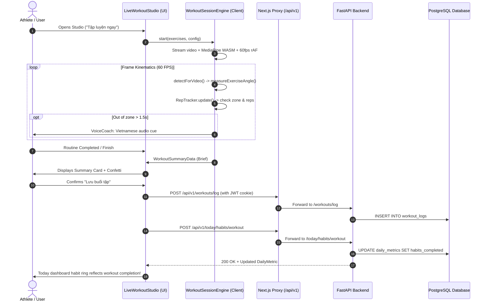

# Workflow: AI Live PT Studio Session & Habit Settlement Loop

## Goal
Provide a seamless, privacy-preserving, in-browser AI coaching workout experience that runs real-time joint kinematic pose tracking at 60 FPS, delivers throttled Vietnamese voice coaching, and defers server synchronization to a single push-right settlement checkpoint upon routine completion.

---

## Loop Dynamics

- **Loop Name**: `workout-studio-session`
- **Domain Concept**: `AI Live PT / Studio` (see `GLOSSARY.md`)
- **Owner**: Frontend UI/UX Agent & Workout Session Engine
- **Cadence**: Triggered on-demand whenever a user initiates a daily workout from `/today` or clicks "Bắt đầu kế hoạch tập Ngày 1" from `/prediction`.

---

## Vocabulary & Primitives

- **Trigger**: User opens `LiveWorkoutStudio` modal or navigates to an active workout session.
- **Push-Right**: The entire workout execution—camera acquisition, MediaPipe WASM detection, 60fps frame loop, joint angle measurement, repetition tallying, out-of-zone voice cues, and accuracy score averaging—runs entirely client-side without chatty API calls.
- **Checkpoint**: A single human-in-the-loop completion gate upon finishing all exercises in the routine (or clicking complete). Confetti fires, voice congratulations play, and a decision-ready **Brief** is presented.
- **Brief**: A high-density summary card displaying:
  1. Total session duration (minutes & seconds).
  2. Calories burned (calculated via metabolic equivalent formula).
  3. Total reps completed.
  4. Average form accuracy percentage (0–100% when camera is active, or `null` if camera off).
  5. Action button: "Lưu buổi tập & hoàn thành".

---

## End-to-End Pipeline Settlement

---

## Architecture & Seams

1. **`WorkoutSessionEngine` (Deep Module)**:
   - Encapsulates all 15 mutable refs, MediaPipe WASM detector loader, WebRTC camera stream, 60fps animation frame loop, and `VoiceCoach` audio synthesis.
   - Presents a minimal observable interface: `start()`, `pause()`, `resume()`, `stop()`, `nextExercise()`, `addCount(n)`, `toggleCamera()`, `toggleMute()`, and `subscribe(listener)`.
   - The interface is the test surface: testable headlessly in Node/tsx without browser DOM, WebGL, or camera hardware.
2. **`useWorkoutSession` (React Adapter)**:
   - Subscribes React components to engine state at a throttled cadence (4Hz HUD or on state changes), keeping the UI 100% reactive without triggering React re-renders on every 60fps frame.
3. **`LiveWorkoutStudio` (Pure Presentation Layer)**:
   - Reduced from 779 lines to ~200 lines, focused solely on modal layout, canvas container ref mounting, and user interaction buttons.
